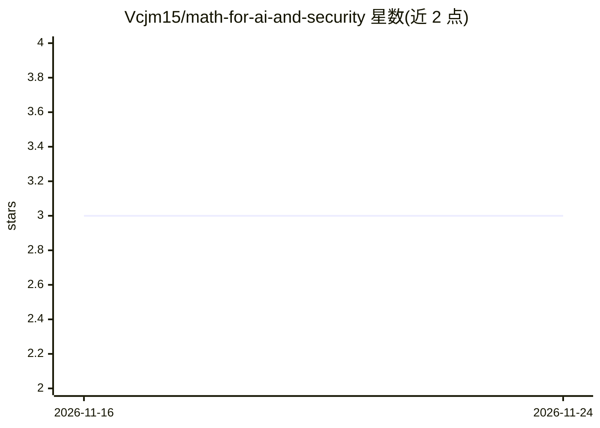

# Vcjm15/math-for-ai-and-security

⭐ 3 · HTML · MIT · 推送 2026-10-09 · [GitHub](https://github.com/Vcjm15/math-for-ai-and-security) · [官网](https://vcjm15.github.io/math-for-ai-and-security/) · 个人维护 · 中文 README

**给高中毕业生的 AI 与密码学数学学习路径教程**

以单个 HTML 文件交付的交互式学习材料，覆盖两条线：从高中补到 AI 所需数学的 9 章路径（离散/连续分界组织，含逻辑证明、微积分、线代、概率、数论、信息论等），以及零基础网络安全与密码学 9 章教程（AES、RSA、TLS、Web 安全等）。内嵌 11 个可拖动实验台、78 道自测题、27 道手算练习与 15 道热身题，答案经程序核验。纯前端零依赖，GitHub Pages 在线预览，可下载 ZIP 离线使用，MIT 许可。

## 筛选速览

| 维度 | 判定 | 备注 |
|---|---|---|
| AI 角色 | `ai-knowledge` | 知识聚合/清单类 |
| 许可风险 | `permissive` | MIT |
| 部署形态 | `None` |  |
| 模型依赖 | — | README 未给出锁定关系 |
| 硬件要求 | — | 无带数字的原话,不猜 |
| 安装摩擦 | `low` | 无编译、无系统依赖或容器化 |
| 成熟度 | — | 结构信号不足 |

## 能力要点

- 单 HTML 文件自包含，零依赖、可完全离线使用
- 11 个可拖动交互实验台（线性变换、梯度下降、RSA 全流程、Diffie-Hellman 等）
- 78 道自测题判分解析 + 27 道手算练习，答案经程序核验
- AES/SHA-256 实现经 NIST 标准测试向量核验

## 适用场景

- 高中毕业生想系统补齐学 AI 所需的数学基础
- 零基础入门网络安全与密码学概念
- 通过交互实验直观理解熵、梯度下降、加密流程

## 场景标签

`教程课程` · 领域:学习与行业

## 证据(README 行号)

> L3: > 一份写给**高中毕业生**的数学学习路径，外加一整套零基础网络安全与密码学教程。
> L4: > 全部内容在一个 HTML 文件里，可以在浏览器直接打开、点、拖、看。
> L16: - **第一部分 · 数学**（9 章）：从断层补起，经四阶段走到 AI 与安全的分叉点

## 星数曲线

2026-11-16 3 → 2026-11-24 3（+0）

---
*卡片 v1 · prompt 1.4 · 生成 2026-11-22 · 置信度 high · 依据 README sha `ee883629d38a` · [字段定义](../../DATASET.md)*
