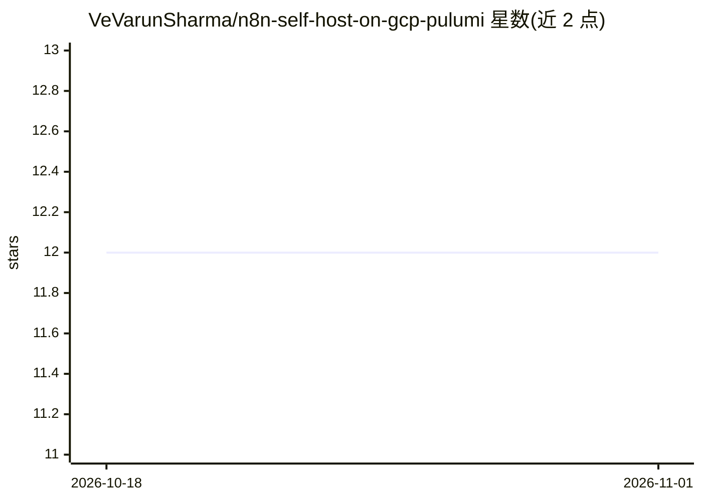

# VeVarunSharma/n8n-self-host-on-gcp-pulumi

⭐ 12 · TypeScript · MIT · 推送 2026-02-15 · [GitHub](https://github.com/VeVarunSharma/n8n-self-host-on-gcp-pulumi) · 个人维护

**用 Pulumi 在 GCP Cloud Run 上自部署 n8n 的基础设施代码**

提供生产可用的模块化 Pulumi（TypeScript）程序，将官方 n8n 容器部署到 Google Cloud Run，后端为 Cloud SQL Postgres 15，敏感值（数据库密码、n8n 加密密钥）存于 Secret Manager，并创建带最小 IAM 角色的专用服务账号。组件包括 ProjectServices、ServiceAccount、Database、Secrets、CloudRunService。面向希望自托管 n8n、掌控数据并控制成本的团队；需自备 GCP 计费项目、gcloud/pulumi CLI、Node.js 18+。README 估算起步配置约 25 美元/月。

## 筛选速览

| 维度 | 判定 | 备注 |
|---|---|---|
| AI 角色 | `ai-ecosystem` | LLM/agent 周边工具 |
| 许可风险 | `permissive` | MIT |
| 部署形态 | `library` | 以包/库形式分发 |
| 模型依赖 | — | README 未给出锁定关系 |
| 硬件要求 | — | 无带数字的原话,不猜 |
| 安装摩擦 | `low` | 无编译、无系统依赖或容器化 |
| 成熟度 | — | 结构信号不足 |

## 能力要点

- Pulumi 组件化结构：API 启用、服务账号、Cloud SQL、Secret Manager、Cloud Run 五个模块
- 部署官方 n8n 镜像并挂载 Cloud SQL proxy、注入密钥
- 起步配置成本估算约 $25/月（Cloud Run 按请求计费）

## 适用场景

- 在自有 GCP 项目内自托管 n8n 工作流自动化
- 以基础设施即代码方式版本化和管理 n8n 部署
- 满足数据不出自有云环境的合规需求

## 场景标签

`工作流自动化` · 领域:效率与自动化

## 证据(README 行号)

> L5: So you want to run n8n without the monthly subscription fees, keep your data under your own control, and avoid the h
> L40: - **Cloud Run Service** (`gcp.cloudrunv2.Service`) hosts the official `docker.io/n8nio/n8n:latest` image with CPU b

## 星数曲线

2026-10-18 12 → 2026-11-01 12（+0）

---
*卡片 v1 · prompt 1.4 · 生成 2026-11-01 · 置信度 high · 依据 README sha `a7aaa2cad03b` · [字段定义](../../DATASET.md)*
