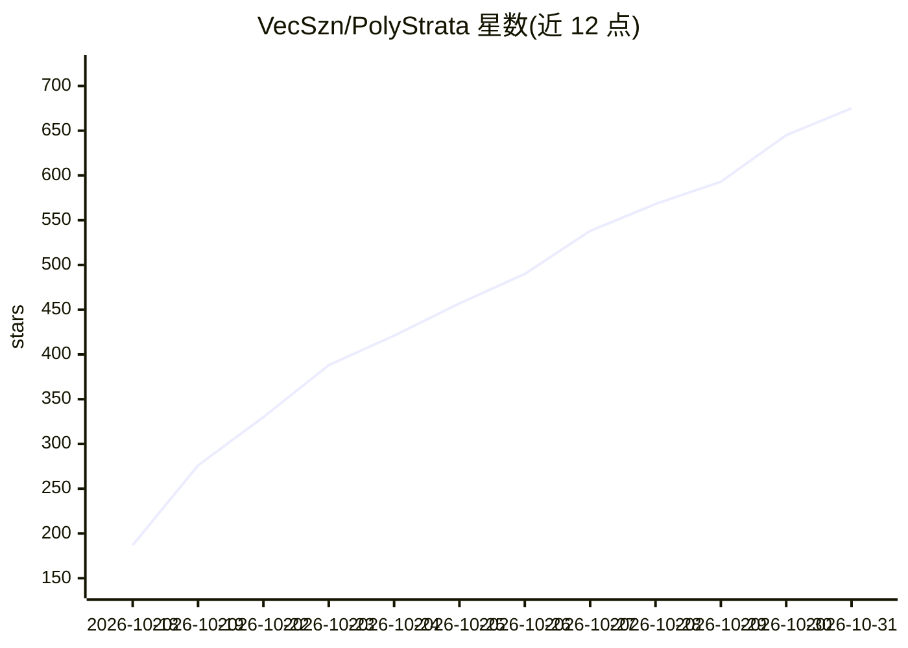

# VecSzn/PolyStrata

⭐ 675 · C++ · MIT · 推送 2026-10-29 · [GitHub](https://github.com/VecSzn/PolyStrata) · 个人维护 · 中文 README

**本地运行大模型的推理引擎，含双引擎九模型与本地 API**

面向在个人电脑上运行大型 AI 模型的推理引擎项目：第一个引擎沿用 Strata 项目，运行 Qwen3.8-Flash-Next；第二个引擎为本项目自写，运行 GLM 5.3 Flash、DeepSeek V4 Flash、LFM2.5、Qwen3.6、Ornith 1.5、Gemma 4、Tiel Coder、MiniCPM-V 共八个模型，后者被声明为实验性。服务器可在运行中切换已安装模型，数据不离开本机。README 给出多硬件（8GB 至 32GB 显存）下的逐模型吞吐测试数据与各量化档位表，并与 llama.cpp 做了实测对比。Windows/Linux 提供一键安装器，其余依赖由安装器配置。

## 筛选速览

| 维度 | 判定 | 备注 |
|---|---|---|
| AI 角色 | `ai-ecosystem` | LLM/agent 周边工具 |
| 许可风险 | `permissive` | MIT |
| 部署形态 | `None` |  |
| 模型依赖 | — | README 未给出锁定关系 |
| 硬件要求 | — | 无带数字的原话,不猜 |
| 安装摩擦 | `high` | 编译与系统依赖俱全 |
| 成熟度 | `idea` | |

## 能力要点

- 双引擎共运行九个大模型，服务器运行中可切换模型
- 在 localhost 提供 OpenAI/Anthropic API，配合 Claude Code 等编码代理
- 逐模型、逐量化档位给出两套硬件上的吞吐实测数据
- 自带基准命令可在用户自己的 PC 上复测

## 适用场景

- 在个人电脑上本地部署和对话、跑编码代理，数据不出本机
- 为应用和编码代理提供本地 OpenAI/Anthropic 兼容 API
- 在不同显存/内存配置下选择合适的模型与量化档位

## 场景标签

`推理引擎` · 领域:训练与推理

## 证据(README 行号)

> L17: PolyStrata runs large AI models on a normal PC, models that usually need a server. They chat, write code and work
> L25: The other eight run on an engine written for PolyStrata, with one NVIDIA card or two: on Linux, and the six smaller
> L44: The server can change between installed models while it runs (how).

## 星数曲线

2026-10-18 187 → 2026-10-31 675（+488）

---
*卡片 v1 · prompt 1.4 · 生成 2026-10-21 · 置信度 high · 依据 README sha `c28938a9f19e` · [字段定义](../../DATASET.md)*
