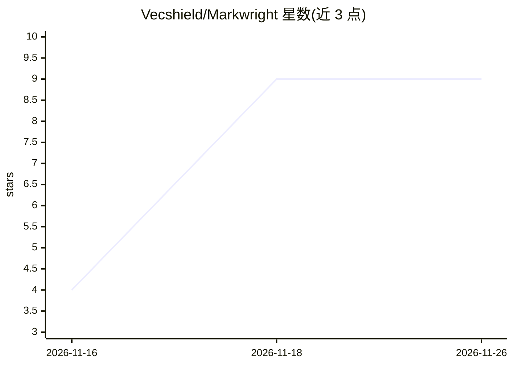

# Vecshield/Markwright

⭐ 9 · Python · Apache-2.0 · 推送 2026-11-17 · [GitHub](https://github.com/Vecshield/Markwright) · 个人维护

**LLM 文本水印的运营控制面：注册、密钥托管与校准验证**

定位为 LLM 文本水印的开源控制面（POC 阶段）：提供模型/方案/版本化配置的注册表（含草稿→激活→废弃生命周期）、密钥托管与轮换（本地密封保险库、HashiCorp Vault/OpenBao Transit）、基于零模型校准的统计验证（p 值 + 95% 区间 + 多重扫描校正）、Ed25519 签名审计链与离线验证包。包装已发表方案（SynthID-Text、KGW）与标准 KMS 原语，自身不发明算法或密码学。文本不落盘，支持气隙部署。

## 筛选速览

| 维度 | 判定 | 备注 |
|---|---|---|
| AI 角色 | `ai-ecosystem` | LLM/agent 周边工具 |
| 许可风险 | `permissive` | Apache-2.0 |
| 部署形态 | `library` | 以包/库形式分发 |
| 模型依赖 | local-ok | 支持本地模型 |
| 硬件要求 | — | 无带数字的原话,不猜 |
| 安装摩擦 | `low` | 无编译、无系统依赖或容器化 |
| 成熟度 | `idea` | |

## 能力要点

- 注册表管理模型/方案/不可变版本化配置，含完整生命周期
- 密钥轮换后旧文本仍可验证，吊销密钥立即停止标记
- 校准验证输出 p 值、95% 区间、假阳性目标与证据带，无布尔判定
- 签名审计链离线验证，提供 HF generate 与 vLLM logits-processor 推理钩子

## 适用场景

- 为已部署 LLM 服务接入文本水印并留存可审计证据
- 密钥轮换后仍需验证历史水印文本的运维场景
- 以校准统计证据而非布尔结论报告水印匹配结果
- 气隙环境下完成水印密钥托管与离线验证

## 场景标签

 · 领域:LLM 基础设施/水印运营

## 证据(README 行号)

> L8: **Your models probably watermark their output already, and nobody can prove it later.** SynthID-Text ships inside HF
> L33: - **Registry**: models, schemes and immutable versioned configurations with a draft → active → deprecated → retired
> L34: - **Key custody**: the database stores references; secret bytes live in a `KeyBackend` (local sealed vault for air-

## 星数曲线

2026-11-16 4 → 2026-11-26 9（+5）

---
*卡片 v1 · prompt 1.4 · 生成 2026-11-20 · 置信度 high · 依据 README sha `9d39f6f839fb` · [字段定义](../../DATASET.md)*
