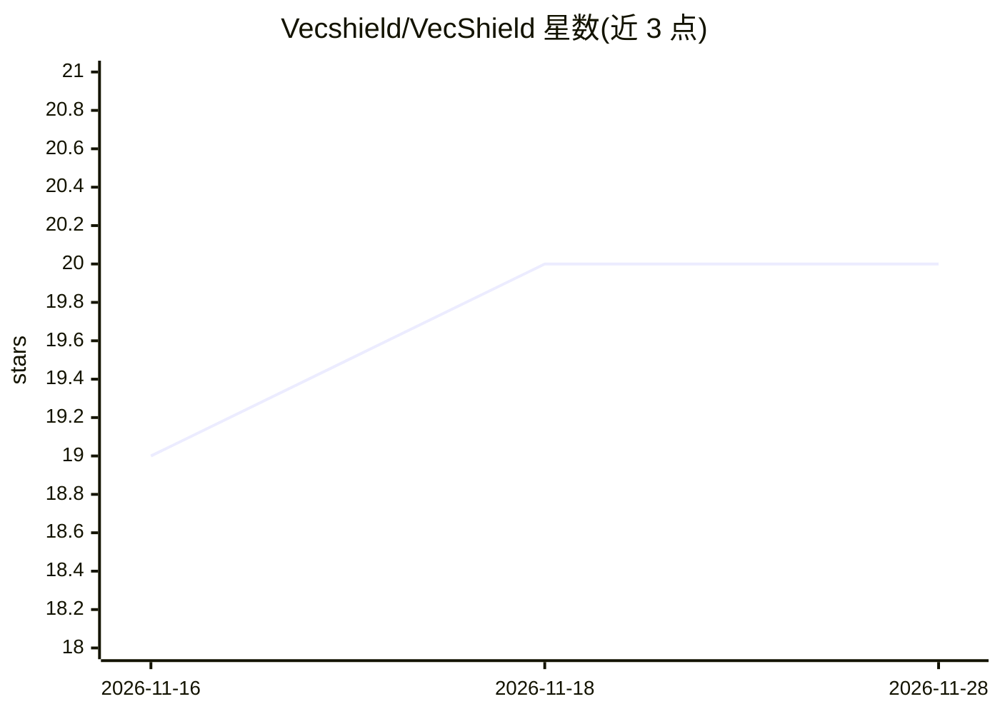

# Vecshield/VecShield

⭐ 20 · Python · Apache-2.0 · 推送 2026-11-26 · [GitHub](https://github.com/Vecshield/VecShield) · [官网](https://vecshield.org/) · 组织维护

**向量数据库与 RAG 管线的安全与合规扫描工具**

由 Apache 2.0 许可的开源项目，提供两部分：检测库 vecshield（在嵌入前对管道中的敏感数据做检查/脱敏，含 CLI）和带 Web 控制台的 vecshield_platform 服务器，接入已有向量库运行五类评估引擎（PII/PHI 扫描、安全态势、完整性、访问控制、合规映射），退出码面向 CI 设计。支持 chroma、pgvector、qdrant、pinecone 等多种连接器 extras。README 明确声明检测不等于合规、清洁结果不证明无问题、不可观测项不计为通过。

## 筛选速览

| 维度 | 判定 | 备注 |
|---|---|---|
| AI 角色 | `ai-ecosystem` | LLM/agent 周边工具 |
| 许可风险 | `permissive` | Apache-2.0 |
| 部署形态 | `self-host` | docker 或自建部署 |
| 模型依赖 | — | README 未给出锁定关系 |
| 硬件要求 | — | 无带数字的原话,不猜 |
| 安装摩擦 | `low` | 无编译、无系统依赖或容器化 |
| 成熟度 | — | 结构信号不足 |

## 能力要点

- 嵌入前入口检测库（check_text / ingest-check / training-check）
- 服务器端五引擎评估：PII/PHI 扫描、态势、完整性、访问、合规
- 退出码面向 CI，未读完整个库不计为通过
- 连接器 extras 覆盖 chroma/pgvector/qdrant/weaviate/milvus/pinecone 等

## 适用场景

- 在数据入库向量库前拦截 PII/PHI/凭据等敏感内容
- 审计已上线向量库中存储数据的安全与合规风险
- 将安全扫描接入 CI 流水线

## 场景标签

`网络安全` · 领域:学习与行业

## 证据(README 行号)

> L25: - **A detection library** (`vecshield`) you call from your own code to keep
> L27: - **A server with a web console** (`vecshield_platform`) that connects to your
> L98: |**Scan**|PII, PHI, payment data and credentials in the stored chunks|

## 星数曲线

2026-11-16 19 → 2026-11-28 20（+1）

---
*卡片 v1 · prompt 1.4 · 生成 2026-11-18 · 置信度 high · 依据 README sha `527e72706d5c` · [字段定义](../../DATASET.md)*
