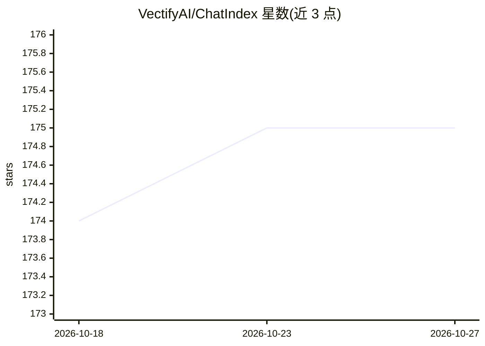

# VectifyAI/ChatIndex

⭐ 175 · Python · Apache-2.0 · 推送 2026-01-08 · [GitHub](https://github.com/VectifyAI/ChatIndex) · 组织维护

**面向长对话的分层树索引与检索系统（Context Tree）**

为 LLM 应用提供长对话上下文管理：在完整保留原始对话之上构建话题层级树（CTree），叶节点存原始消息，内部节点存话题摘要；查询时 LLM 自顶向下遍历，按需返回摘要或原文，实现多分辨率检索与无损回退。建树需设置 OpenAI API key，支持增量建树与流式输出，可绕过 LLM 包装直接调用工具。以 Python 库形式提供，通过 git clone 源码与 pip 安装依赖使用。

## 筛选速览

| 维度 | 判定 | 备注 |
|---|---|---|
| AI 角色 | `ai-ecosystem` | LLM/agent 周边工具 |
| 许可风险 | `permissive` | Apache-2.0 |
| 部署形态 | `library` | 以包/库形式分发 |
| 模型依赖 | — | README 未给出锁定关系 |
| 硬件要求 | — | 无带数字的原话,不猜 |
| 安装摩擦 | `low` | 无编译、无系统依赖或容器化 |
| 成熟度 | — | 结构信号不足 |

## 能力要点

- 叶节点存原始消息、内部节点存话题摘要的 Context Tree 结构
- LLM 推理驱动的自顶向下多分辨率检索，原始对话始终可回退
- 增量建树（话题切换检测）与时间有序的树结构
- 提供流式查询与直接工具调用两种使用方式

## 适用场景

- 长对话 AI 助手中高效检索历史上下文
- 降低长上下文带来的成本与推理退化
- 按需获取不同粒度（摘要或原文）的对话信息

## 场景标签

`Agent 记忆` · 领域:Agent 开发

## 证据(README 行号)

> L3: ChatIndex is a context management system that enables LLMs to efficiently navigate and utilize long conversation his
> L17: ChatIndex is designed to meet these requirements by constructing a hierarchical tree index — which we call a Contex

## 星数曲线

2026-10-18 174 → 2026-10-27 175（+1）

---
*卡片 v1 · prompt 1.4 · 生成 2026-10-22 · 置信度 mid · 依据 README sha `a407aa132f6a` · [字段定义](../../DATASET.md)*
