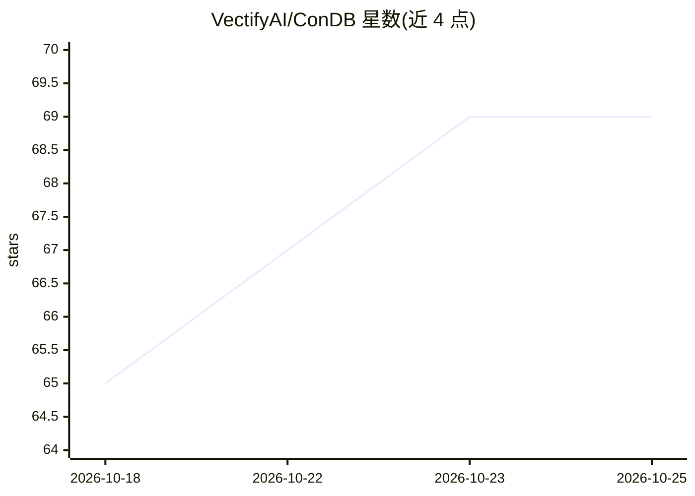

# VectifyAI/ConDB

⭐ 69 · Python · Apache-2.0 · 推送 2026-09-21 · [GitHub](https://github.com/VectifyAI/ConDB) · [官网](https://pageindex.ai) · 组织维护

**面向推理检索的 KV-cache 原生上下文数据库**

ConDB 是树结构的上下文数据库，用 LLM 推理式树搜索替代向量相似度检索，不依赖向量库与分块。接受 PageIndex 文档树、ChatIndex 会话树、文件系统树和自定义层级 JSON，层级数据存于 SQLite。提供 Beam（小树）与 Block（大文档）两种检索策略，Block 模式缓存中间结果以复用 LLM KV-cache，宣称降低至多 70% token 用量。开箱支持 Anthropic 与 OpenAI，可自定义存储后端、LLM 提供方与检索策略，附带基准测试脚本。以 Python 库（pip 依赖安装）形式提供给开发者。

## 筛选速览

| 维度 | 判定 | 备注 |
|---|---|---|
| AI 角色 | `ai-ecosystem` | LLM/agent 周边工具 |
| 许可风险 | `permissive` | Apache-2.0 |
| 部署形态 | `library` | 以包/库形式分发 |
| 模型依赖 | locked-api |  |
| 硬件要求 | — | 无带数字的原话,不猜 |
| 安装摩擦 | `low` | 无编译、无系统依赖或容器化 |
| 成熟度 | — | 结构信号不足 |

## 能力要点

- 推理式树搜索替代向量检索，无需向量库与分块
- KV-cache 原生：Block 模式缓存中间结果，降低至多 70% token 用量
- Beam 与 Block 两种检索策略按树规模自动选择
- 可插拔存储后端、LLM 提供方与检索策略，支持 Anthropic/OpenAI

## 适用场景

- 为长文档或代码库构建层级索引并做推理式检索
- agent 记忆与长会话等动态长上下文的存取与推理
- 对比 Block/Beam/Vertical 检索算法的效果与成本

## 场景标签

`Agent 记忆` `RAG` · 领域:Agent 开发

## 证据(README 行号)

> L10: **ConDB** (Context Database) is a tree-structured context database that uses LLM-powered **reasoning-based retrieva
> L18: ConDB replaces this with **reasoning-based tree search**: the LLM performs node-level relevance classification over

## 星数曲线

2026-10-18 65 → 2026-10-25 69（+4）

---
*卡片 v1 · prompt 1.4 · 生成 2026-10-24 · 置信度 high · 依据 README sha `98187ea45c4a` · [字段定义](../../DATASET.md)*
