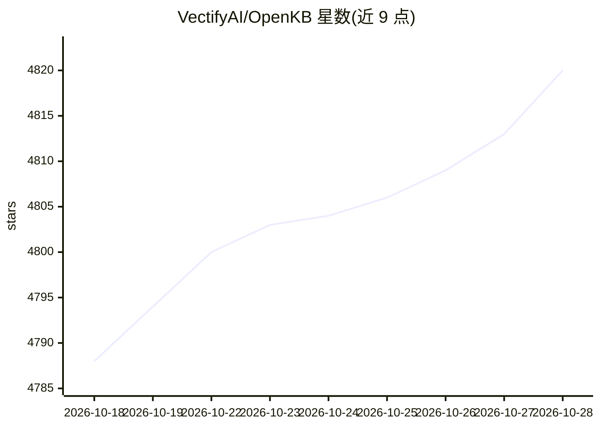

# VectifyAI/OpenKB

⭐ 4,820 · Python · Apache-2.0 · 推送 2026-07-22 · [GitHub](https://github.com/VectifyAI/OpenKB) · [官网](https://pageindex.ai) · 组织维护

**把原始文档编译成可查询 wiki 知识库的 CLI 系统**

由 VectifyAI（PageIndex）维护的开源 CLI 系统：用 LLM 将 PDF、Word、Markdown、HTML、URL 等文档编译为持久化、互相链接的 wiki 式知识库（摘要页、概念页、实体页、交叉引用），长 PDF 经 PageIndex 树索引做无向量检索。在其上提供 query/chat 带引用问答、知识图谱可视化、Skill Factory（蒸馏可被 Claude Code/Codex/Gemini 安装的 agent 技能）与 HTML 幻灯片生成。LLM 经 LiteLLM 接入多家服务商，需自备 API key；附带 Web UI（openkb-web）。

## 筛选速览

| 维度 | 判定 | 备注 |
|---|---|---|
| AI 角色 | `ai-native` | 本体是模型或模型工具 |
| 许可风险 | `permissive` | Apache-2.0 |
| 部署形态 | `library` | 以包/库形式分发 |
| 模型依赖 | — | README 未给出锁定关系 |
| 硬件要求 | — | 无带数字的原话,不猜 |
| 安装摩擦 | `low` | 无编译、无系统依赖或容器化 |
| 成熟度 | — | 结构信号不足 |

## 能力要点

- 多格式文档编译为 wiki（摘要/概念/实体页与交叉引用，自动同步）
- PageIndex 无向量树索引处理长 PDF，原生多模态（图表/图片）检索
- query/chat 带引用问答，Skill Factory 蒸馏可分发 agent 技能
- wiki 为纯 .md 文件，兼容 Obsidian 与 Google OKF 规范

## 适用场景

- 把论文、书籍、文档库整理成可持续积累的结构化知识库
- 在自己的知识库上做多轮问答与带引用的检索
- 从知识库蒸馏可分发的 agent 技能供 Claude Code 等使用

## 场景标签

`知识库管理` `知识图谱` `文档问答` · 领域:知识与检索

## 证据(README 行号)

> L18: **OpenKB (Open Knowledge Base)** is an open-source system (in CLI) that compiles raw documents into a structured, i
> L160: |<code>openkb&nbsp;query&nbsp;"question"</code>|A grounded answer with citations (`--save` to persist to `wiki/exp
> L188: `openkb skill new` distills a portable agent skill from your wiki that Claude Code, Codex, and Gemini can install 

## 星数曲线

2026-10-18 4,788 → 2026-10-28 4,820（+32）

---
*卡片 v1 · prompt 1.4 · 生成 2026-10-20 · 置信度 mid · 依据 README sha `8dce02d14cce` · [字段定义](../../DATASET.md)*
