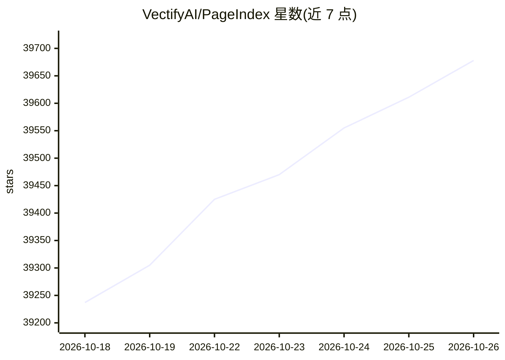

# VectifyAI/PageIndex

⭐ 39,678 · Python · MIT · 推送 2026-10-25 · [GitHub](https://github.com/VectifyAI/PageIndex) · [官网](https://pageindex.ai) · 组织维护

**无向量库、基于 LLM 推理的树状索引 RAG 引擎**

以文档层级树索引替代向量索引的 RAG 引擎：先为每份 PDF 生成树状索引（索引模型仅做摘要精炼），再由 LLM 在树上多步推理完成检索，检索结果可溯源到具体引用。本地模式通过 pip 安装 SDK，使用自有 LLM key 完成 indexing/retrieve/chat；亦可切换到云端 API key，云端另提供 OCR、图像理解与托管存储。README 给出索引成本（约每页 $0.001）、查询成本对比与 FinanceBench 评测数据。面向处理金融报告、法律文件、技术手册等长文档的开发者，本地方案限文本型 PDF、不含 OCR。

## 筛选速览

| 维度 | 判定 | 备注 |
|---|---|---|
| AI 角色 | `ai-native` | 本体是模型或模型工具 |
| 许可风险 | `permissive` | MIT |
| 部署形态 | `library` | 以包/库形式分发 |
| 模型依赖 | locked-api |  |
| 硬件要求 | — | 无带数字的原话,不猜 |
| 安装摩擦 | `low` | 无编译、无系统依赖或容器化 |
| 成熟度 | — | 结构信号不足 |

## 动量与使用信号

- 维护:`active` — 距上次 push 0.7 天,年发版 22,16 位贡献者
- 涨星:近 1 天 **+84**(自 20261016 起算)
- 安装:pypi 包 `pageindex` 月下载 117,984
- 平台:— · 协议:MCP

## 能力要点

- 树状索引 + LLM 推理检索，无需向量库与分块
- SDK 本地模式：索引/检索/对话全在本机，使用自有 LLM key
- 可通过 Claude Code 订阅调用 Claude 模型，无需 API key
- 同一客户端可切换 PageIndex Cloud（OCR、图像理解、托管存储）

## 适用场景

- 对金融/法律等长文档做可溯源的问答检索
- 在本地用自己的模型 key 搭建无向量库的 RAG 流程
- 将 PageIndex 工具接入 OpenAI Agents SDK / Claude Agent SDK 等自有 agent

## 场景标签

`RAG` `文档问答` · 领域:知识与检索

## 证据(README 行号)

> L28: Inspired by AlphaGo, **PageIndex** replaces the vector index with a **hierarchical tree index** and lets an LLM **r
> L39: <blockquote>PageIndex is a vectorless , reasoning-based RAG engine that mirrors how humans read , delivering tracea

## 星数曲线

2026-10-18 39,237 → 2026-10-26 39,678（+441）

---
*卡片 v1 · prompt 1.4 · 生成 2026-10-20 · 置信度 high · 依据 README sha `358819603324` · [字段定义](../../DATASET.md)*
