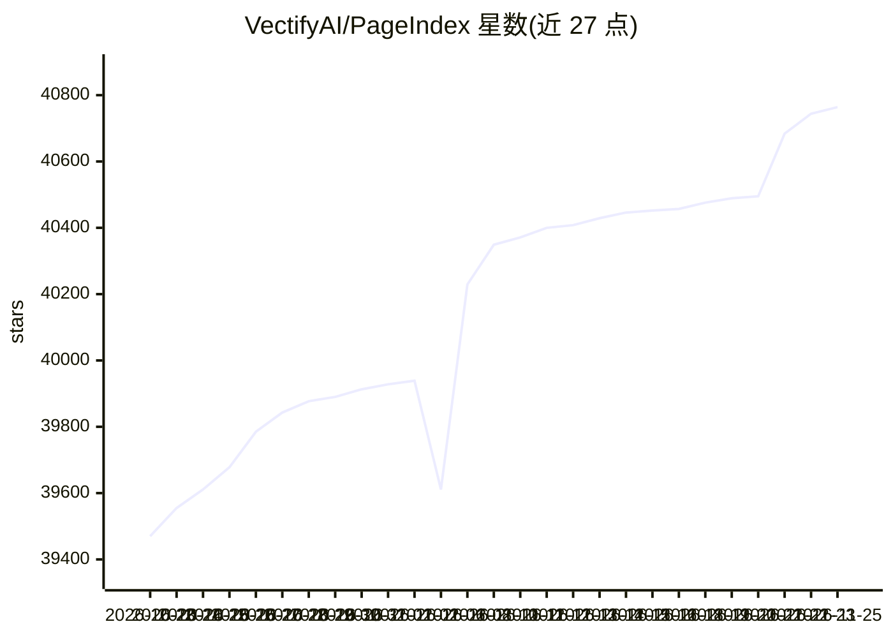

# VectifyAI/PageIndex

⭐ 40,764 · Python · MIT · 推送 2026-11-21 · [GitHub](https://github.com/VectifyAI/PageIndex) · [官网](https://pageindex.ai) · 组织维护

**为开发者提供无向量库、基于树索引推理的 RAG 引擎**

PageIndex 将文档索引为树结构，检索时由 LLM 通过推理遍历该树定位相关页面，不使用向量数据库与分块。提供本地与云端两种模式：本地支持文本型 PDF 的索引、检索与带页码引用的问答；云端托管索引与存储，支持扫描件与图像文档、框级引用、MCP server。以 Python SDK（pip 包）提供，模型接入遵循 LiteLLM 命名，支持 OpenAI/Anthropic/OpenRouter 等，也可将工具接入已有 agent 框架。

## 筛选速览

| 维度 | 判定 | 备注 |
|---|---|---|
| AI 角色 | `ai-ecosystem` | LLM/agent 周边工具 |
| 许可风险 | `permissive` | MIT |
| 部署形态 | `library` | 以包/库形式分发 |
| 模型依赖 | — | README 未给出锁定关系 |
| 硬件要求 | — | 无带数字的原话,不猜 |
| 安装摩擦 | `low` | 无编译、无系统依赖或容器化 |
| 成熟度 | — | 结构信号不足 |

## 动量与使用信号

- 维护:`active` — 距上次 push 0.7 天,年发版 22,16 位贡献者
- 涨星:近 1 天 **+84**(自 20261016 起算)
- 安装:pypi 包 `pageindex` 月下载 117,984
- 平台:— · 协议:MCP

## 能力要点

- 文档索引为树结构，检索由 LLM 推理遍历树完成
- 引用可定位到页码，云端支持页内证据框选
- 支持多轮对话、跨文档提问与流式输出
- 提供工具与系统提示供接入 OpenAI/Anthropic/Claude agent SDK

## 适用场景

- 对财报、法律文件等长文档做问答检索
- 回答需要可追溯页码引用的场景
- 把文档检索工具接入自己的 agent
- 本地用自有 API key 索引并查询 PDF 文档

## 场景标签

`RAG` · 领域:知识与检索

## 证据(README 行号)

> L43: <blockquote>PageIndex is a vectorless , reasoning-based RAG engine that mirrors how humans read , delivering tracea
> L30: Inspired by AlphaGo, **PageIndex** replaces the vector index with a **hierarchical tree index** and lets an LLM **r
> L271: Your agent keeps its own model and gets PageIndex's tools to find and read your indexed documents, so the client n

## 星数曲线

2026-10-23 39,470 → 2026-11-25 40,764（+1,294）

---
*卡片 v1 · prompt 1.4 · 生成 2026-11-22 · 置信度 high · 依据 README sha `5b3be52b5dd0` · [字段定义](../../DATASET.md)*
