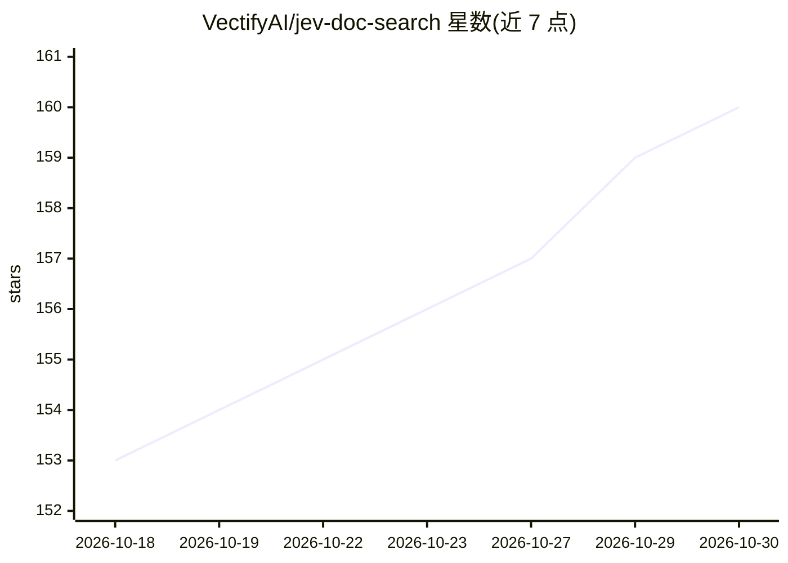

# VectifyAI/jev-doc-search

⭐ 160 · Python · Apache-2.0 · 推送 2026-10-03 · [GitHub](https://github.com/VectifyAI/jev-doc-search) · [官网](pageindex.ai) · 组织维护

**面向开发者的长文档检索方案：用 Jev Choice 树搜索定位 PDF 页面**

由 VectifyAI 提供的长文档页面定位工具与示例代码集：不依赖向量库与嵌入，将“哪一页回答此问题”建模为 Jev 的 Choice 多选题，逐级在 PageIndex 生成的文档层级树（文档→章节→页）上做选择，配合深度树、top-K 权重搜索与 Noul 验证三步，可在数百页文档中定位答案页。以 Python 脚本（page_search.py / tree_search.py）形式提供，需 pip 安装依赖并配置 TypeSafe 与 PageIndex 云服务 API key。Apache 2.0 许可。

## 筛选速览

| 维度 | 判定 | 备注 |
|---|---|---|
| AI 角色 | `ai-native` | 本体是模型或模型工具 |
| 许可风险 | `permissive` | Apache-2.0 |
| 部署形态 | `library` | 以包/库形式分发 |
| 模型依赖 | — | README 未给出锁定关系 |
| 硬件要求 | — | 无带数字的原话,不猜 |
| 安装摩擦 | `low` | 无编译、无系统依赖或容器化 |
| 成熟度 | — | 结构信号不足 |

## 能力要点

- 无需向量库与嵌入的 Choice 多选式页面检索
- PageIndex 将文档构建为文档→章节→页的层级树，绕过 32k token 与 255 选项上限
- 深度树 + top-K 权重搜索 + Noul 逐页阈值验证的完整流程
- 对 93/318 页年报示例均可定位到正确答案页

## 适用场景

- 在数百页年报、员工手册等 PDF 中定位回答某问题的具体页面
- 复用 doc_id 对同一文档连续提问，避免重复上传
- 作为无嵌入长文档检索方案的技术参考

## 场景标签

`RAG` · 领域:知识与检索

## 证据(README 行号)

> L3: **Find the page that answers a question in a 300-page report with Jev's `Choice`. No vector DB or embeddings!**
> L5: Jev answers multiple-choice questions: give it the options, and it returns a probability for each. "Which page answe
> L116: python tree_search.py NVIDIA_10K.pdf "What was NVIDIA's total revenue for fiscal year 2026?"

## 星数曲线

2026-10-18 153 → 2026-10-30 160（+7）

---
*卡片 v1 · prompt 1.4 · 生成 2026-10-22 · 置信度 high · 依据 README sha `f0c83f105f7b` · [字段定义](../../DATASET.md)*
