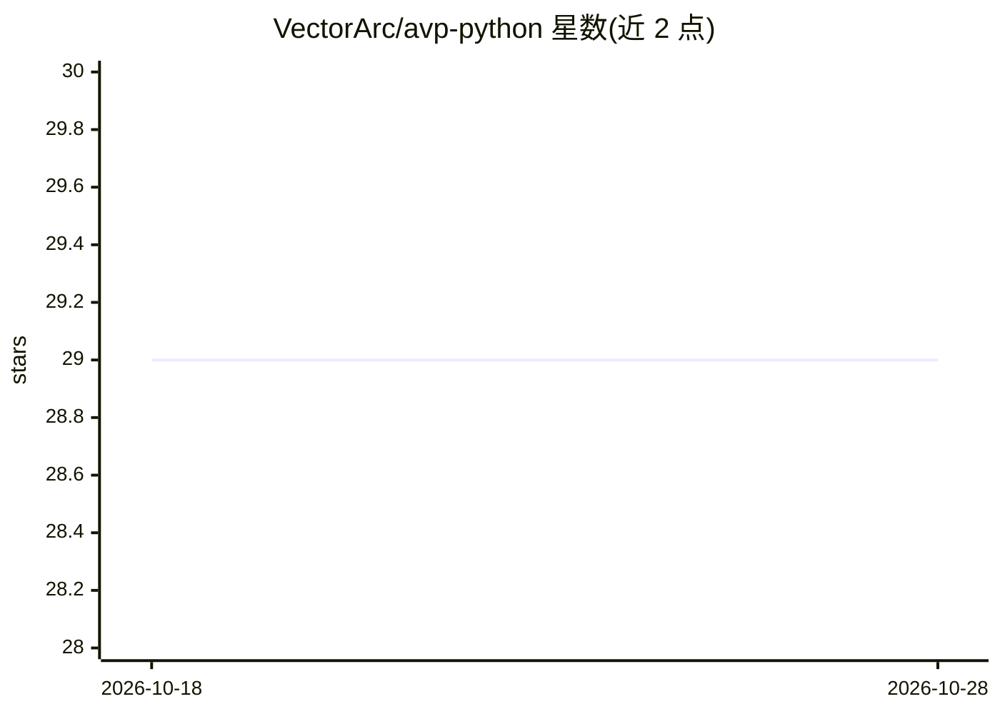

# VectorArc/avp-python

⭐ 29 · Python · Apache-2.0 · 推送 2026-04-26 · [GitHub](https://github.com/VectorArc/avp-python) · 组织维护

**多智能体间直接传输 KV-cache 的 Python SDK**

Agent Vector Protocol 的 Python SDK：在 LLM 智能体交接时传输 KV-cache、隐藏状态等模型内部计算，替代文本传递，使接收方模型接续前序计算。握手自动协商传输模式：同模型传完整 KV-cache、跨模型走共享词表投影（约 6 KB）、不兼容则回退 JSON 文本。支持 HuggingFace/Ollama/llama.cpp/vLLM 引擎及 LangChain/CrewAI/AutoGen 集成。需自托管 GPU 模型，零训练即可跨模型族使用。

## 筛选速览

| 维度 | 判定 | 备注 |
|---|---|---|
| AI 角色 | `ai-ecosystem` | LLM/agent 周边工具 |
| 许可风险 | `permissive` | Apache-2.0 |
| 部署形态 | `library` | 以包/库形式分发 |
| 模型依赖 | local-ok | 支持本地模型 |
| 硬件要求 | — | 无带数字的原话,不猜 |
| 安装摩擦 | `medium` | 含编译或系统依赖之一 |
| 成熟度 | — | 结构信号不足 |

## 能力要点

- 智能体间 KV-cache/隐藏状态传输，握手自动协商传输模式
- 跨模型零训练投影（共享词表，约 6 KB）与 JSON 文本回退
- 支持 HuggingFace/Ollama/llama.cpp/vLLM 四种引擎
- 上下文可序列化（to_bytes/from_bytes）跨进程传输

## 适用场景

- 多智能体流水线中降低交接开销、提升吞吐
- 不同模型架构的智能体间共享推理上下文
- 通过 LangChain/CrewAI/AutoGen 集成到现有 agent 框架

## 场景标签

`多智能体` `Agent 框架` · 领域:Agent 开发

## 证据(README 行号)

> L10: When LLM agents hand off work as text, the next agent re-processes everything from scratch. AVP (Agent Vector Proto
> L83: AVP auto-negotiates the transfer mode via a handshake at connection time. You write the same `think()` / `generate(

## 星数曲线

2026-10-18 29 → 2026-10-28 29（+0）

---
*卡片 v1 · prompt 1.4 · 生成 2026-10-26 · 置信度 high · 依据 README sha `8bc9a5db2ca2` · [字段定义](../../DATASET.md)*
