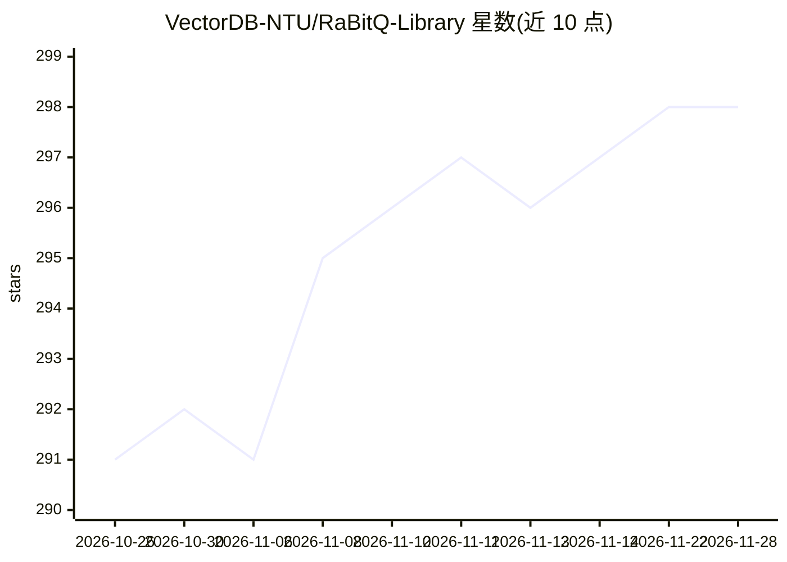

# VectorDB-NTU/RaBitQ-Library

⭐ 298 · C++ · Apache-2.0 · 推送 2026-11-27 · [GitHub](https://github.com/VectorDB-NTU/RaBitQ-Library) · [官网](https://vectordb-ntu.github.io/RaBitQ-Library/) · 组织维护 · 中文 README

**给需要向量检索的开发者提供带理论误差界的量化与 ANN 索引库**

研究背景的 C++/Python 库，实现 RaBitQ 1–9 位向量量化与近似最近邻搜索，包含 IVF-RaBitQ、HNSW-RaBitQ、SymphonyQG 三种索引，支持 L2、内积、余弦三种度量，可增删向量；也提供 core 与 FastScan 组件供嵌入自建引擎。Python 经 PyPI 安装（wheel 覆盖多平台），C++ 通过源码集成指南构建。x86-64 需 AVX2/FMA（可选 AVX-512），ARM64 用 NEON。作者包含 RaBitQ 原作者。

## 筛选速览

| 维度 | 判定 | 备注 |
|---|---|---|
| AI 角色 | `ai-native` | 本体是模型或模型工具 |
| 许可风险 | `permissive` | Apache-2.0 |
| 部署形态 | `library` | 以包/库形式分发 |
| 模型依赖 | — | README 未给出锁定关系 |
| 硬件要求 | — | 无带数字的原话,不猜 |
| 安装摩擦 | `low` | 无编译、无系统依赖或容器化 |
| 成熟度 | — | 结构信号不足 |

## 能力要点

- 三种索引支持 L2/内积/余弦与向量增删
- 1–9 位量化编码具理论误差界
- core/FastScan 组件可独立集成到自有引擎
- SIMD 内核（AVX2/AVX-512/NEON）加速构建与查询

## 适用场景

- 为嵌入检索场景搭建可保存/加载的 ANN 索引
- 把量化编码组件接入自研向量搜索引擎
- 复现 RaBitQ 论文的实验与基准测试

## 场景标签

`向量数据库` · 领域:知识与检索

## 证据(README 行号)

> L8: RaBitQ-Library is a research-backed library for vector quantization and
> L18: - **Use an index or the quantizer.** Build ready-made indexes in Python or C++,
> L44: |IVF-RaBitQ|Partitioned search with batch scoring.|1–9-bit codes or raw-vector reranking; add/remove.|

## 星数曲线

2026-10-26 291 → 2026-11-28 298（+7）

---
*卡片 v1 · prompt 1.4 · 生成 2026-11-25 · 置信度 high · 依据 README sha `5f3511cd3b52` · [字段定义](../../DATASET.md)*
