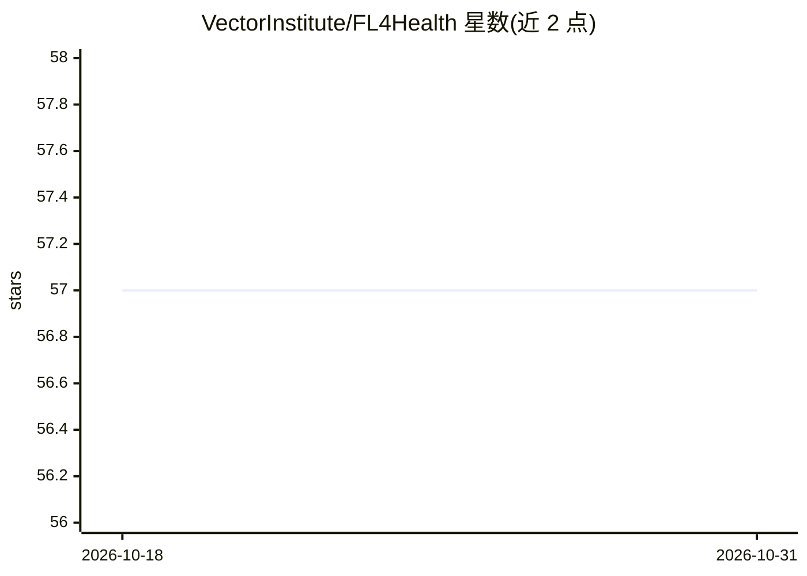

# VectorInstitute/FL4Health

⭐ 57 · Python · NOASSERTION · 推送 2026-10-26 · [GitHub](https://github.com/VectorInstitute/FL4Health) · [官网](https://vectorinstitute.github.io/FL4Health/) · 组织维护

**面向医疗场景的联邦学习研究框架，基于 Flower 扩展**

由 Vector Institute 维护的联邦学习库，构建在开源 FL 框架 Flower 之上，面向医疗场景的 FL 研究与实验。实现约 20 种 FL 策略：非个性化方法（FedAvg、FedOpt、FedProx、SCAFFOLD、MOON 等）与个性化方法（FedBN、FedPer、Ditto、APFL、GPFL 等）。提供差分隐私训练（实例级/客户端级）、联邦检查点、特征对齐、参数交换、模型基座与 Weights & Biases 报告等组件。仅支持 PyTorch 模型的检查点。限制：部分模块（预处理、PRV 会计师）仍在扩展中。

## 筛选速览

| 维度 | 判定 | 备注 |
|---|---|---|
| AI 角色 | `ai-ecosystem` | LLM/agent 周边工具 |
| 许可风险 | `none` | NOASSERTION |
| 部署形态 | `library` | 以包/库形式分发 |
| 模型依赖 | — | README 未给出锁定关系 |
| 硬件要求 | — | 无带数字的原话,不猜 |
| 安装摩擦 | `low` | 无编译、无系统依赖或容器化 |
| 成熟度 | — | 结构信号不足 |

## 能力要点

- 约 20 种 FL 策略（非个性化 + 个性化），基于 Flower 扩展
- 实例级与客户端级（自适应裁剪）差分隐私训练支持
- 联邦检查点：客户端可在训练过程中任意时点存档模型
- 自动特征对齐：通过初始通信轮次解决客户端特征维度/顺序不一致

## 适用场景

- 在分布式医疗数据上训练模型而不共享原始数据
- 研究对比个性化与非个性化联邦学习策略
- 为联邦训练实验接入差分隐私与实验日志追踪

## 场景标签

`模型训练` `科研工具` · 领域:学习与行业

## 证据(README 行号)

> L10: Principally, this repository contains the federated learning (FL) engine aimed at facilitating FL research, experim
> L14: The library source code is housed in the `fl4health` folder. This library is built on the foundational components o

## 星数曲线

2026-10-18 57 → 2026-10-31 57（+0）

---
*卡片 v1 · prompt 1.4 · 生成 2026-10-24 · 置信度 high · 依据 README sha `3a99916c914b` · [字段定义](../../DATASET.md)*
