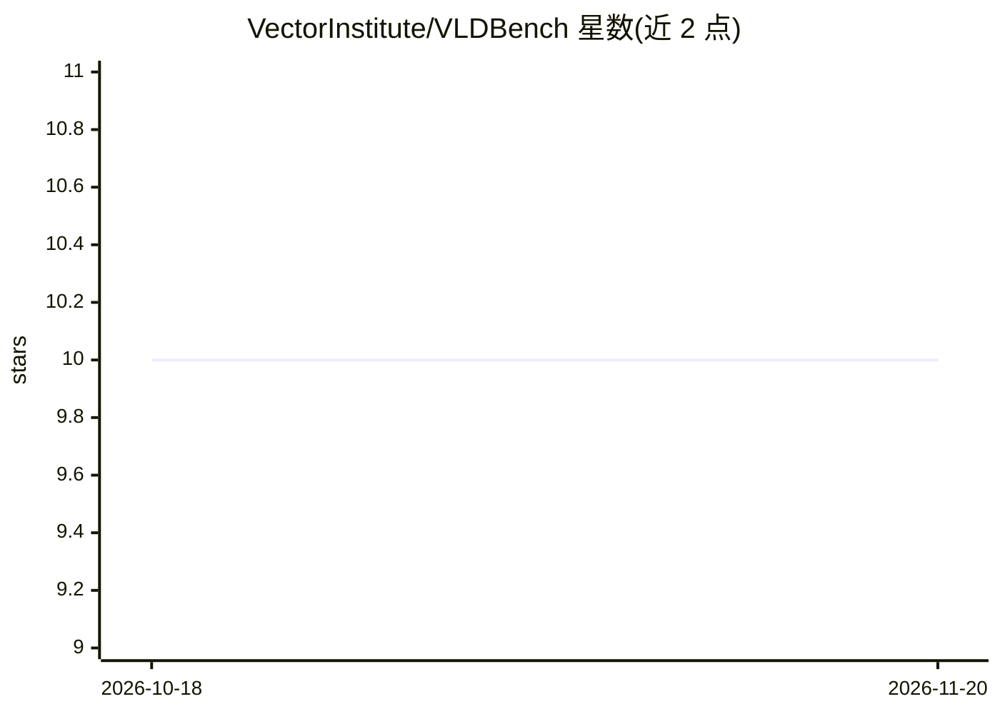

# VectorInstitute/VLDBench

⭐ 10 · Python · 推送 2026-01-19 · [GitHub](https://github.com/VectorInstitute/VLDBench) · [官网](https://vectorinstitute.github.io/VLDBench/) · 组织维护

**评测 LLM/VLM 多模态虚假信息检测的基准数据集**

VLDBench 是一个多模态虚假信息检测基准：由 22 名领域专家人工核验的 62,000+ 新闻文章-图像对，覆盖 13 个新闻类别，来自 58 个新闻源，支持纯文本与图文多模态两种分类任务。README 列出评测的 19 个模型（9 个 LLM、10 个 VLM）的榜单，并报告多模态模型较单模态准确率高 5-15%、指令微调可提升检测效果等发现，附论文引用信息。数据集托管在 Hugging Face，面向研究者、开发者与政策制定者。README 未提供安装或运行命令。

## 筛选速览

| 维度 | 判定 | 备注 |
|---|---|---|
| AI 角色 | `ai-knowledge` | 知识聚合/清单类 |
| 许可风险 | `none` | — |
| 部署形态 | `None` |  |
| 模型依赖 | — | README 未给出锁定关系 |
| 硬件要求 | — | 无带数字的原话,不猜 |
| 安装摩擦 | `low` | 无编译、无系统依赖或容器化 |
| 成熟度 | `idea` | |

## 能力要点

- 62,000+ 人工核验的新闻文章-图像对，13 个类别
- 支持纯文本与多模态（文本+图像）分类评测
- 评测 19 个模型：9 个 LLM 与 10 个 VLM
- 数据集托管于 Hugging Face

## 适用场景

- 评测 LLM/VLM 在虚假信息检测上的表现
- 对模型在 VLDBench 上做指令微调以提升检测能力
- 研究多模态与单模态模型的鲁棒性差异

## 场景标签

`模型评测` `多模态` · 领域:评测与运维

## 证据(README 行号)

> L14: With the increasing impact of **Generative AI** in shaping digital narratives, detecting **disinformation** has bec
> L24: ## 📊 **Dataset**
> L9:  📊 Dataset: Hugging Face

## 星数曲线

2026-10-18 10 → 2026-11-20 10（+0）

---
*卡片 v1 · prompt 1.4 · 生成 2026-11-20 · 置信度 high · 依据 README sha `9c259734122e` · [字段定义](../../DATASET.md)*
