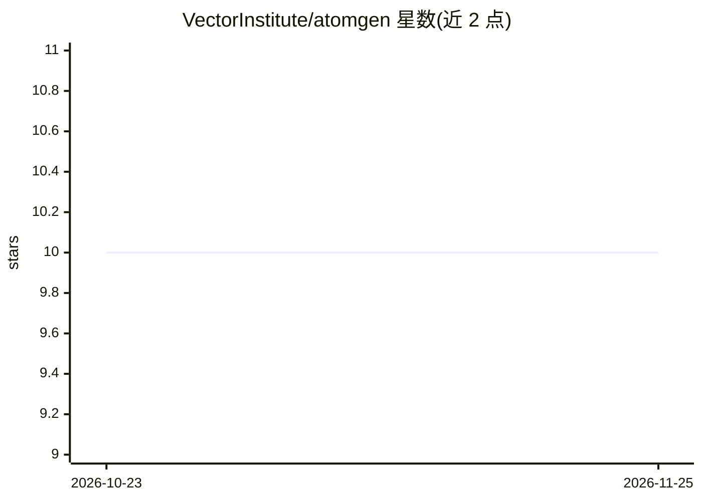

# VectorInstitute/atomgen

⭐ 10 · Python · Apache-2.0 · 推送 2026-11-23 · [GitHub](https://github.com/VectorInstitute/atomgen) · [官网](https://vectorinstitute.github.io/AtomGen/) · 组织维护

**面向材料/分子研究的原子图数据与 Transformer 训练库**

AtomGen 提供处理原子图数据集的框架，聚焦 Transformer 类实现：聚合并标准化来自 OC20、OC22、ODAC23、MPtrj、SPICE、PDB、OQMD 等多源数据集，支持训练 AtomFormer、SchNet、TokenGT 等模型，并提供结构到能量/力预测、掩码原子建模、坐标去噪三类预训练任务。预训练数据集与模型发布在 Hugging Face Hub，可通过 datasets API 访问。安装基于 uv 管理 Python 环境。

## 筛选速览

| 维度 | 判定 | 备注 |
|---|---|---|
| AI 角色 | `ai-native` | 本体是模型或模型工具 |
| 许可风险 | `permissive` | Apache-2.0 |
| 部署形态 | `None` |  |
| 模型依赖 | — | README 未给出锁定关系 |
| 硬件要求 | — | 无带数字的原话,不猜 |
| 安装摩擦 | `low` | 无编译、无系统依赖或容器化 |
| 成熟度 | — | 结构信号不足 |

## 能力要点

- 多源原子图数据集的聚合与标准化流程
- 支持 AtomFormer、SchNet、TokenGT 三种模型训练
- 三种预训练任务可经 DataCollatorForAtomModeling 单独或同时使用
- 预训练数据集与模型发布于 Hugging Face Hub

## 适用场景

- 为材料科学任务做原子图模型的大规模预训练
- 在 OC20 等数据集上微调预训练原子模型
- 实验不同的原子图预训练任务

## 场景标签

`模型训练` `微调` · 领域:训练与推理

## 证据(README 行号)

> L10: AtomGen provides a robust framework for handling atomistic graph datasets focusing on transformer-based implementat
> L35: AtomGen supports a variety of models for training on atomistic graph datasets, including:

## 星数曲线

2026-10-23 10 → 2026-11-25 10（+0）

---
*卡片 v1 · prompt 1.4 · 生成 2026-11-20 · 置信度 high · 依据 README sha `3e59704b8290` · [字段定义](../../DATASET.md)*
