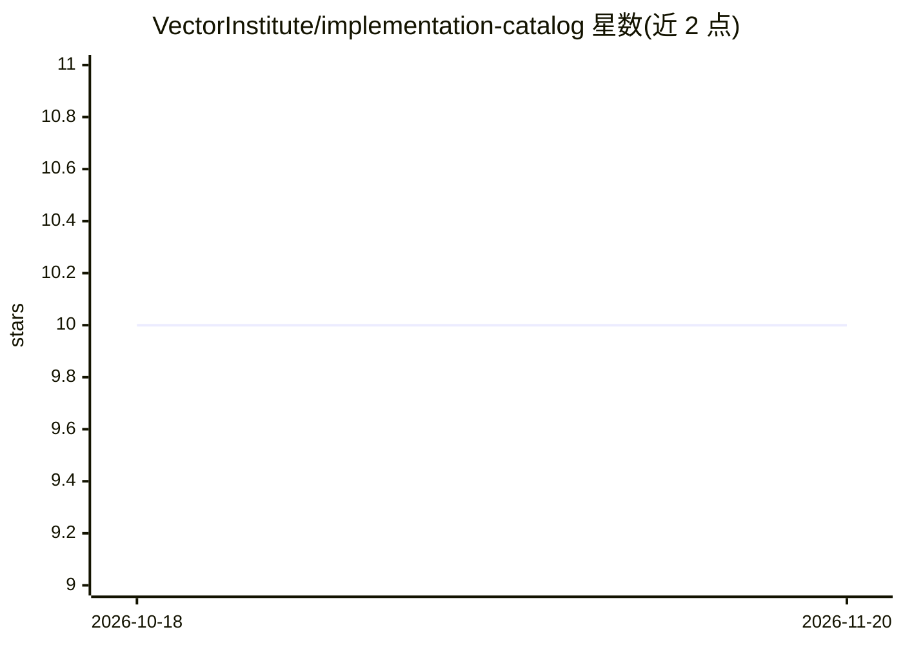

# VectorInstitute/implementation-catalog

⭐ 10 · TypeScript · 推送 2026-11-18 · [GitHub](https://github.com/VectorInstitute/implementation-catalog) · [官网](https://catalog.vectorinstitute.ai/) · 组织维护

**Vector Institute 的机器学习实现仓库编目清单**

Vector Institute 维护的机器学习技术与算法实现仓库目录，将收录条目以 YAML 文件描述（名称、repo_id、算法列表、类型、年份、数据集与论文链接等字段），并生成静态网站发布于 GitHub Pages：支持 Pagefind 客户端即时搜索、按 applied-research/bootcamp/tool 类型过滤、无后端部署。另含分析仪表盘，通过 GitHub Actions 每周自动采集各仓库的 star/fork、访问与克隆量及 PyPI 下载统计。

## 筛选速览

| 维度 | 判定 | 备注 |
|---|---|---|
| AI 角色 | `ai-knowledge` | 知识聚合/清单类 |
| 许可风险 | `none` | — |
| 部署形态 | `library` | 以包/库形式分发 |
| 模型依赖 | — | README 未给出锁定关系 |
| 硬件要求 | — | 无带数字的原话,不猜 |
| 安装摩擦 | `low` | 无编译、无系统依赖或容器化 |
| 成熟度 | — | 结构信号不足 |

## 能力要点

- YAML 定义仓库条目，含算法列表、论文 URL、BibTeX 等字段
- Pagefind 客户端搜索与三类目过滤的静态站点
- GitHub Actions 每周自动采集 GitHub 与 PyPI 指标

## 适用场景

- 查找 Vector Institute 发布的 ML 实现与教程仓库
- 跟踪目录内仓库的 star、访问、下载等指标趋势
- 以统一格式登记新实现条目并发布目录网站

## 场景标签

`教程课程` `精选清单` · 领域:学习与行业

## 证据(README 行号)

> L3: This catalog is a collection of repositories for various Machine Learning techniques and algorithms implemented at V
> L52: - **type**: Classification - `tool`, `bootcamp`, or `applied-research`

## 星数曲线

2026-10-18 10 → 2026-11-20 10（+0）

---
*卡片 v1 · prompt 1.4 · 生成 2026-11-20 · 置信度 mid · 依据 README sha `578ea57d0e0a` · [字段定义](../../DATASET.md)*
