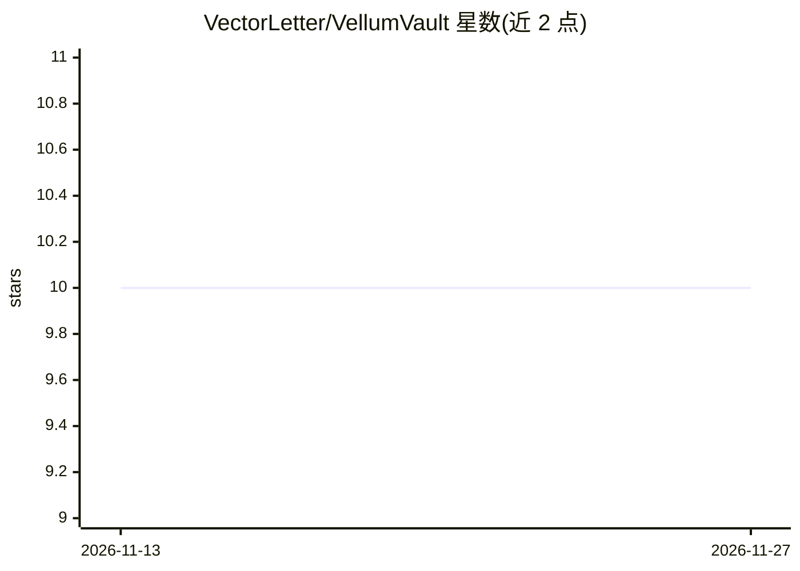

# VectorLetter/VellumVault

⭐ 10 · Python · MIT · 推送 2026-06-26 · [GitHub](https://github.com/VectorLetter/VellumVault) · 个人维护 · 中文 README

**本地优先归档工具：把视频/文章/文档转为 AI 总结的 Markdown 知识库**

本地优先的内容归档工具：粘贴链接或拖入文件后自动执行下载（yt-dlp）、字幕提取/语音转写（faster-whisper）、正文提取（trafilatura/readability 及各平台专属提取器）、PDF/DOCX 解析与 AI 结构化摘要，统一输出 Markdown 归档。AI 推理默认经 LM Studio 在本机运行，也可配置任意 OpenAI 兼容 API；不配置 LLM 时可用 --no-summary 跳过总结。提供 Web UI、CLI、HTTP API、飞书机器人四种入口，支持 Cloudflare Tunnel 公网访问与 macOS LaunchAgent 自启动。

## 筛选速览

| 维度 | 判定 | 备注 |
|---|---|---|
| AI 角色 | `ai-native` | 本体是模型或模型工具 |
| 许可风险 | `permissive` | MIT |
| 部署形态 | `None` |  |
| 模型依赖 | — | README 未给出锁定关系 |
| 硬件要求 | — | 无带数字的原话,不猜 |
| 安装摩擦 | `medium` | 含编译或系统依赖之一 |
| 成熟度 | — | 结构信号不足 |

## 能力要点

- 视频→字幕/转写→AI 结构化摘要，支持 YouTube/B站/抖音/TikTok/微信视频号
- PDF 体裁识别与 Vision LLM 逐页转写，DOCX 保留表格与嵌入图片
- 四种入口：Web UI、CLI、HTTP API、飞书机器人
- AI 后端本地 LM Studio 与 OpenAI 兼容云端 API 可切换，可跳过 AI 总结

## 适用场景

- 把收藏的视频和文章批量转成带摘要的 Markdown 归档
- 微信公众号/知乎/小红书内容的本地化存档与防失效
- 扫描版 PDF 和 PPT 型文档转写为可检索文本
- 通过飞书机器人提交链接、后台归档并接收完成通知

## 场景标签

`语音识别` `文档解析` `知识库管理` · 领域:知识与检索

## 证据(README 行号)

> L5: VellumVault 是一个**本地优先**的内容归档工具。粘贴一个链接（或拖入一个文件），它会自动完成抓取、下载、格式转换、AI 总结，最终输出干净的 Markdown 文件。
> L7: 所有 AI 推理默认在你自己的机器上运行（通过 LM Studio），也支持接入 OpenAI / DeepSeek 等任意 OpenAI 兼容 API。
> L224: 可以。配置云端 API（如 DeepSeek、OpenAI）即可。或者设置 `--no-summary` 跳过 AI 总结，只做下载/转换/归档。

## 星数曲线

2026-11-13 10 → 2026-11-27 10（+0）

---
*卡片 v1 · prompt 1.4 · 生成 2026-11-20 · 置信度 high · 依据 README sha `97e008b05025` · [字段定义](../../DATASET.md)*
