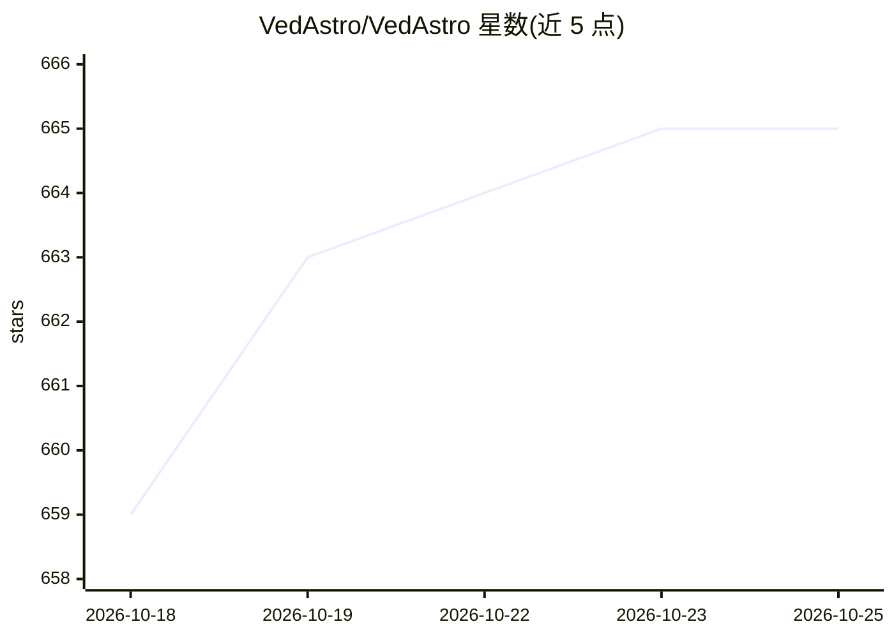

# VedAstro/VedAstro

⭐ 666 · C# · MIT · 推送 2026-10-04 · [GitHub](https://github.com/VedAstro/VedAstro) · [官网](https://vedastro.org) · 组织维护

**开源印度占星平台：面向普通用户的算命/合婚工具与 API**

始于 2014 年的非营利开源项目，提供吠陀占星计算与预测工具：网站、AI 占星师、人生预测、命盘生成（100+ 预测与分盘）、合婚匹配（10 种 Kuta 方法）、数秘、AI 解梦、地震预测（实验性）等。面向开发者的部分：200+ 端点的 REST API、MCP Server（接入 Claude/Cursor/VS Code）、NuGet .NET 库、pip Python 库、Docker 自托管镜像、WordPress 插件与移动客户端，另发布 15,000 名人出生与婚姻数据集供 ML 研究。预测机制为"事件预测 =（数据+逻辑）×时间"，核心库为 .NET。

## 筛选速览

| 维度 | 判定 | 备注 |
|---|---|---|
| AI 角色 | `ai-native` | 本体是模型或模型工具 |
| 许可风险 | `permissive` | MIT |
| 部署形态 | `library` | 以包/库形式分发 |
| 模型依赖 | — | README 未给出锁定关系 |
| 硬件要求 | — | 无带数字的原话,不猜 |
| 安装摩擦 | `low` | 无编译、无系统依赖或容器化 |
| 成熟度 | — | 结构信号不足 |

## 能力要点

- 200+ 占星计算端点的 REST API 与 MCP Server
- 合婚（10 种 Kuta 方法）、命盘、人生预测、AI 占星师等工具集
- pip install VedAstro Python 库与 NuGet .NET 库、Docker 自托管
- 15,000 名人出生数据与婚姻数据集供 ML 研究

## 适用场景

- 普通用户查询命盘、合婚匹配与每日 Panchang
- 开发者通过 API/MCP Server 在应用中嵌入占星计算
- 研究人员使用名人出生与婚姻数据集做 ML 实验
- 自托管完整占星 API 服务

## 场景标签

`聊天机器人` · 领域:对话与助手

## 证据(README 行号)

> L12: - **AI Astrologer** — 🤖 World's 1st open source **Vedic AI astrologer**
> L26: - **MCP Server** — plug VedAstro tools into **Claude, Cursor, VS Code** and any MCP client (docs)

## 星数曲线

2026-10-18 659 → 2026-10-25 665（+6）

---
*卡片 v1 · prompt 1.4 · 生成 2026-10-21 · 置信度 high · 依据 README sha `091d46a6448c` · [字段定义](../../DATASET.md)*
