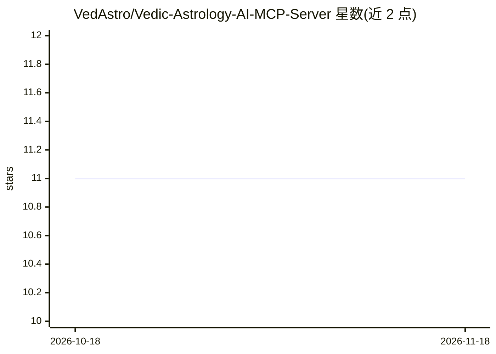

# VedAstro/Vedic-Astrology-AI-MCP-Server

⭐ 11 · TypeScript · 推送 2026-03-25 · [GitHub](https://github.com/VedAstro/Vedic-Astrology-AI-MCP-Server) · [官网](https://vedastro.org/MCPServerApp.html) · 组织维护

**把吠陀占星计算通过 MCP 提供给 AI 助手的工具服务器**

基于 VedAstro 的瑞士星历表（Raman Ayanamsa）引擎构建的 MCP 服务器，托管在 https://mcp.vedastro.org/api/mcp，使用 Streamable HTTP 传输，基础设施为 Azure Functions v4 (Node.js)。提供 6 个工具：200+ 条人生预测的星盘解读、16 Kuta 因素的配对报告、Chaldean 数字命理、9 星 12 宫原始数据、24 项通用占星属性与 Ashtakvarga 图表。免费层每分钟 5 次请求，$1/月 API key 解除限制；用户将 URL 粘贴到 Claude Desktop、Cursor、ChatGPT、Gemini 等客户端即可使用。

## 筛选速览

| 维度 | 判定 | 备注 |
|---|---|---|
| AI 角色 | `ai-ecosystem` | LLM/agent 周边工具 |
| 许可风险 | `none` | — |
| 部署形态 | `library` | 以包/库形式分发 |
| 模型依赖 | — | README 未给出锁定关系 |
| 硬件要求 | — | 无带数字的原话,不猜 |
| 安装摩擦 | `low` | 无编译、无系统依赖或容器化 |
| 成熟度 | `idea` | |

## 能力要点

- 6 个 MCP 工具覆盖星盘预测、配对、数字命理、行星/宫位数据
- 单一 URL 接入，支持 URL 路径或 header 两种 API key 认证方式
- 免费层每分钟 5 次请求，$1/月 API key 解除限制
- 瑞士星历表引擎，无状态计算、声明不存储个人数据

## 适用场景

- 在 Claude Desktop 里用自己的出生信息获取吠陀星盘预测
- 比较两个人的星盘生成 16 Kuta 配对报告
- 让 AI 客户端读取行星与宫位原始数据做详细分析

## 场景标签

 · 领域:占星/娱乐内容服务

## 证据(README 行号)

> L11: **🔗 MCP Server Endpoint**
> L29: VedAstro's MCP Server brings the full power of Vedic astrology — horoscope predictions, compatibility matching, num
> L165: |**Transport**|Streamable HTTP|

## 星数曲线

2026-10-18 11 → 2026-11-18 11（+0）

---
*卡片 v1 · prompt 1.4 · 生成 2026-11-18 · 置信度 low · 依据 README sha `d42a0191227b` · [字段定义](../../DATASET.md)*
