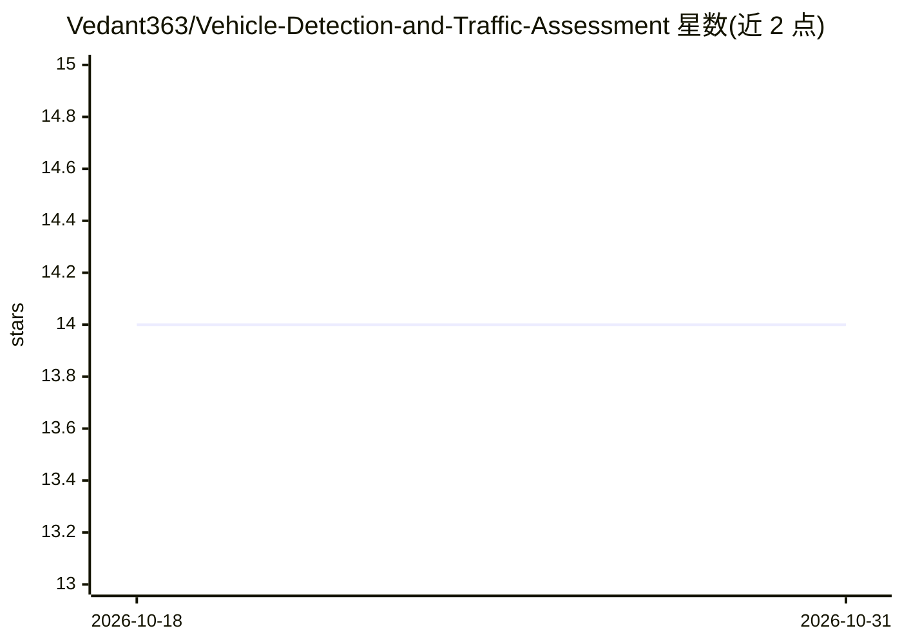

# Vedant363/Vehicle-Detection-and-Traffic-Assessment

⭐ 14 · Jupyter Notebook · CC0-1.0 · 推送 2026-05-03 · [GitHub](https://github.com/Vedant363/Vehicle-Detection-and-Traffic-Assessment) · 个人维护

**YOLO11L 实时车辆检测与交通分析系统，带数据记录**

基于自训练 YOLO11L（COCO 基础模型+印度交通类别自定义模型）的实时车辆检测 Web 应用：Flask 后端处理 OpenCV/yt-dlp 视频流，输出车辆计数、平均速度、拥堵检测、重型车占比、清空时间与红绿灯配时建议；检测结果实时写入 Google Sheets 并以 Chart.js 呈现交互图表。凭据经 GPG 加密，支持本地运行、NGROK 隧道（Colab/Kaggle）与 Docker 三种部署方式。

## 筛选速览

| 维度 | 判定 | 备注 |
|---|---|---|
| AI 角色 | `ai-native` | 本体是模型或模型工具 |
| 许可风险 | `viral` | CC0-1.0 |
| 部署形态 | `self-host` | docker 或自建部署 |
| 模型依赖 | — | README 未给出锁定关系 |
| 硬件要求 | — | 无带数字的原话,不猜 |
| 安装摩擦 | `low` | 无编译、无系统依赖或容器化 |
| 成熟度 | — | 结构信号不足 |

## 能力要点

- YOLO11L 检测多类车辆，含印度交通类别（auto-rickshaw、scooter 等）
- 检测结果实时记录到 Google Sheets（含跟踪 ID 与置信度）
- 实时交通指标：拥堵检测、重型车密度、红绿灯配时建议
- 提供本地 / NGROK 隧道 / Docker 三种运行方式

## 适用场景

- 对视频流做实时车辆检测与类别统计
- 监测路段拥堵并获取红绿灯配时建议
- 将检测数据落表 Google Sheets 做后续分析

## 场景标签

`目标检测` `数据分析` · 领域:效率与自动化

## 证据(README 行号)

> L3: > Real-time vehicle detection and traffic analysis system powered by a self-trained **YOLO11L model**, with live dat
> L24: Detects multiple vehicle types in real-time using a **combination of the base YOLO11L model** (pre-trained COCO cla
> L61: |Object Detection|YOLOv11L (Ultralytics)|

## 星数曲线

2026-10-18 14 → 2026-10-31 14（+0）

---
*卡片 v1 · prompt 1.4 · 生成 2026-10-31 · 置信度 high · 依据 README sha `631be6a7d4ea` · [字段定义](../../DATASET.md)*
