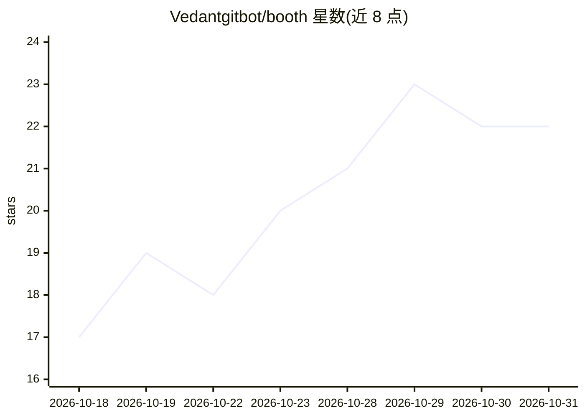

# Vedantgitbot/booth

⭐ 22 · Python · MIT · 推送 2026-10-30 · [GitHub](https://github.com/Vedantgitbot/booth) · [官网](https://pypi.org/project/boothpy/) · 个人维护

**零依赖的 LLM 输出校验层：结构化判定是否信任模型回答**

面向 LLM 应用开发者的 Python 检查点库：在模型响应与应用后续动作之间插入校验层，提供 check()（解析、歧义、置信度、自定义验证器，失败按原因重试）、check_with_evidence()（用应用提供的比较函数核验答案与证据，自身不调用 LLM）和异步 acheck() 三个 API，输出结构化 BoothResult（ACCEPTED/REPAIRED/AMBIGUOUS/UNCERTAIN/BLOCKED）。零依赖、供应商无关，模型调用函数、证据检索均由应用侧提供。提供 Groq、Gemini、Anthropic、Ollama 的可运行集成示例及 RAG 比较器研究记录，声明示例结果非通用准确性保证。

## 筛选速览

| 维度 | 判定 | 备注 |
|---|---|---|
| AI 角色 | `ai-ecosystem` | LLM/agent 周边工具 |
| 许可风险 | `permissive` | MIT |
| 部署形态 | `library` | 以包/库形式分发 |
| 模型依赖 | local-ok | 支持本地模型 |
| 硬件要求 | — | 无带数字的原话,不猜 |
| 安装摩擦 | `low` | 无编译、无系统依赖或容器化 |
| 成熟度 | — | 结构信号不足 |

## 能力要点

- check/check_with_evidence/acheck 三种校验 API，返回结构化 BoothResult 与五种状态码
- 零依赖、供应商无关，应用自带模型调用函数与比较器
- 证据核验模式（check_with_evidence）不自行调用 LLM
- 提供 Groq/Gemini/Anthropic/Ollama 集成示例与 NLI/关键词比较器的对比记录

## 适用场景

- LLM 应用在执行模型输出前拦截低置信、歧义或无证据的回答
- 退款政策等文档问答场景中核验答案是否与给定证据一致
- 区分模型调用失败与校验失败等不同故障类型

## 场景标签

`模型评测` · 领域:评测与运维

## 证据(README 行号)

> L36: BOOTH adds a checkpoint between an LLM response and your application's next action. It returns a structured `BoothR
> L109: BOOTH provides three primary APIs:
> L177: BOOTH has zero dependencies and is provider-agnostic. Your application supplies the model-calling function, so BOO

## 星数曲线

2026-10-18 17 → 2026-10-31 22（+5）

---
*卡片 v1 · prompt 1.4 · 生成 2026-10-28 · 置信度 high · 依据 README sha `cee2685be3c8` · [字段定义](../../DATASET.md)*
