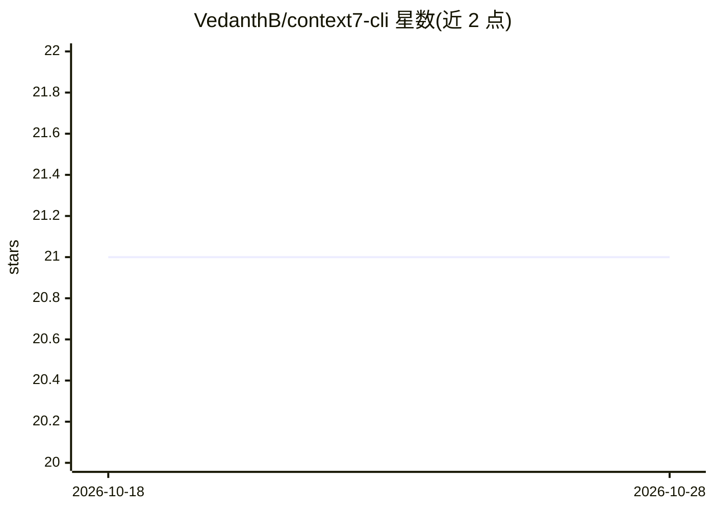

# VedanthB/context7-cli

⭐ 21 · JavaScript · 推送 2026-10-26 · [GitHub](https://github.com/VedanthB/context7-cli) · [官网](https://vedanthb.github.io/context7-cli/) · 个人维护

**在终端获取最新版库文档的 Context7 CLI，无需 MCP**

基于 Context7 文档数据的命令行工具：通过 resolve 与 fetch 两次 API 调用，把库的版本特定文档以纯文本输出到 stdout，可设定 token 上限与主题过滤。基础用法无需 API key，配置 key 可获得更高速率限制。代码仅 170 行、零 npm 依赖，使用 Node 内置 fetch。定位为 MCP 服务之外的使用通道，输出可通过管道送入任意 LLM、脚本或 CI 流程。给需要将文档喂给编码 agent 或做快速 API 查阅的开发者使用。

## 筛选速览

| 维度 | 判定 | 备注 |
|---|---|---|
| AI 角色 | `ai-ecosystem` | LLM/agent 周边工具 |
| 许可风险 | `none` | — |
| 部署形态 | `library` | 以包/库形式分发 |
| 模型依赖 | — | README 未给出锁定关系 |
| 硬件要求 | — | 无带数字的原话,不猜 |
| 安装摩擦 | `low` | 无编译、无系统依赖或容器化 |
| 成熟度 | — | 结构信号不足 |

## 能力要点

- 纯文本 stdout 输出，可管道组合 grep/jq/shell 脚本
- 支持按主题过滤与 --tokens 上限（默认 5000）
- 零 npm 依赖，两次 API 调用完成 resolve+fetch
- 基础用法无需 API key

## 适用场景

- 把库文档直接喂给 Claude Code 或本地 LLM 编码 agent
- 在终端快速查阅某库某 API 的最新版文档
- 对比不同版本的库文档差异
- 在 CI 与自动化脚本中注入文档上下文

## 场景标签

 · 领域:开发者工具/文档获取

## 证据(README 行号)

> L17: - Pipe into any LLM (Claude Code, Ollama, llama.cpp, whatever)
> L62: **Feed docs into coding agents:**

## 星数曲线

2026-10-18 21 → 2026-10-28 21（+0）

---
*卡片 v1 · prompt 1.4 · 生成 2026-10-28 · 置信度 high · 依据 README sha `e4c84d843940` · [字段定义](../../DATASET.md)*
