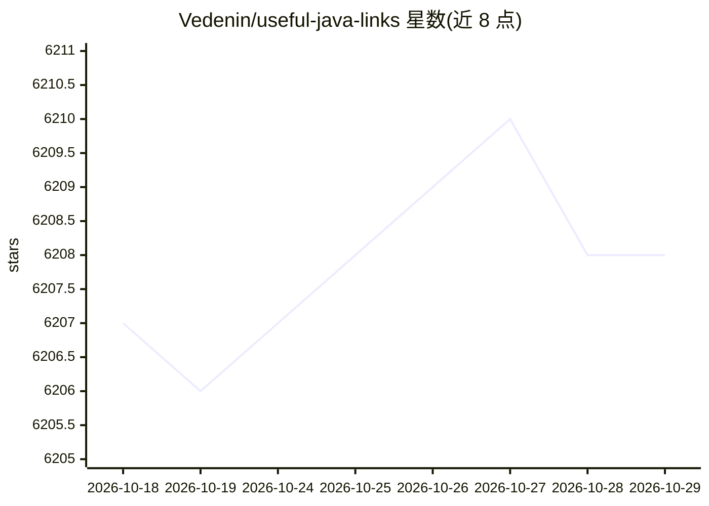

# Vedenin/useful-java-links

⭐ 6,208 · Java · NOASSERTION · 推送 2026-05-08 · [GitHub](https://github.com/Vedenin/useful-java-links) · 个人维护

**Java 框架与库的策展清单：给开发者按类别找库**

一个 awesome 风格的 Java 资源清单（awesome-java 的 fork），按开发、Web 开发等类别组织条目，收录 GitHub 390 星以上的非移动项目，每条附简介、许可证与是否商业友好的标注，另有许可证信息与星标数补充。README 中含少量 AI 相关条目（如 Embedchain-JS）与 machine-learning 主题标签。清单另链接俄语版本与 Hello World 示例项目。

## 筛选速览

| 维度 | 判定 | 备注 |
|---|---|---|
| AI 角色 | `ai-knowledge` | 知识聚合/清单类 |
| 许可风险 | `permissive` | NOASSERTION |
| 部署形态 | `None` |  |
| 模型依赖 | — | README 未给出锁定关系 |
| 硬件要求 | — | 无带数字的原话,不猜 |
| 安装摩擦 | `high` | 编译与系统依赖俱全 |
| 成熟度 | — | 结构信号不足 |

## 能力要点

- 按通用框架、Web 框架、Web 库等类别组织的条目结构
- 每条附许可证及商业友好许可标注
- 收录 GitHub 390 星以上非移动项目并附星标信息
- 链接俄语版本与独立的 Hello World 示例项目

## 适用场景

- 按类别查找并比较 Java 框架与库
- 选型时快速核对候选库的许可证是否商业友好
- 了解 Java 生态中高星开源项目的覆盖范围

## 场景标签

`精选清单` · 领域:学习与行业

## 证据(README 行号)

> L1: # Useful Java links
> L2: This is a fork of awesome link with new structure, additional license info and github's star info for every link, wi
> L43: 1. Embedchain-JS Framework to easily create LLM powered bots over any dataset. GitHub stars

## 星数曲线

2026-10-18 6,207 → 2026-10-29 6,208（+1）

---
*卡片 v1 · prompt 1.4 · 生成 2026-10-20 · 置信度 high · 依据 README sha `52065a07c3f1` · [字段定义](../../DATASET.md)*
