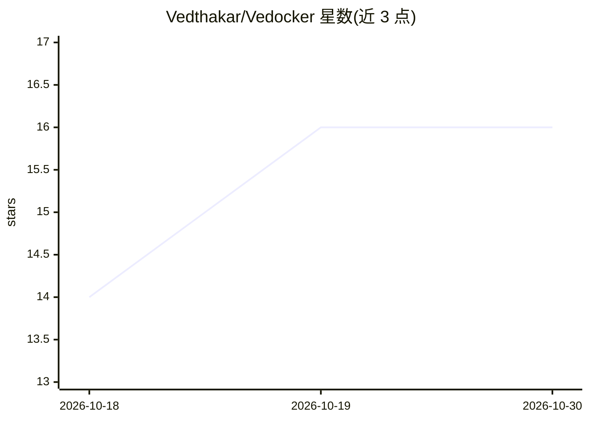

# Vedthakar/Vedocker

⭐ 16 · Go · MIT · 推送 2026-10-04 · [GitHub](https://github.com/Vedthakar/Vedocker) · 个人维护

**用 Go 从零实现的 Docker/Kubernetes 平台：粘贴 GitHub 链接即部署**

基于 Go 与 Linux namespaces/cgroups/iptables 从零构建的容器平台，不依赖 Docker Engine、containerd 或 Kubernetes。粘贴 GitHub URL 即可克隆、构建并运行仓库；无 Dockerfile 时由 Gemini 分析仓库并生成经验证的 Dockerfile。含自有镜像存储、Dockerfile 构建引擎、Kubernetes 式编排（Pod/Deployment/自愈 reconcile 循环）、实时仪表盘、MCP 服务器与浏览器扩展。要求 Linux、root、Go 1.25+、Node 18+ 与 git；多副本 Service 负载均衡尚未实现；守护进程以 root 运行仓库代码，部署前需确认。

## 筛选速览

| 维度 | 判定 | 备注 |
|---|---|---|
| AI 角色 | `ai-enhanced` | 去掉 AI 部分产品仍成立 |
| 许可风险 | `permissive` | MIT |
| 部署形态 | `self-host` | docker 或自建部署 |
| 模型依赖 | — | README 未给出锁定关系 |
| 硬件要求 | — | 无带数字的原话,不猜 |
| 安装摩擦 | `low` | 无编译、无系统依赖或容器化 |
| 成熟度 | — | 结构信号不足 |

## 能力要点

- 克隆/检测/构建/运行/日志流一条龙的 GitHub URL 部署
- 无 Dockerfile 时 Gemini 生成并经校验的 Dockerfile
- 从零实现容器运行时、镜像存储、构建引擎与自愈编排
- MCP 服务器与 Chrome/Firefox 浏览器扩展

## 适用场景

- 粘贴链接直接运行刚发现的 GitHub 仓库
- 让 Claude Code/Cursor 等 AI 助手代为部署并读取日志
- 通过阅读源码学习 Docker 与 Kubernetes 内部机制

## 场景标签

 · 领域:开发者工具/容器基础设施

## 证据(README 行号)

> L24: Vedocker is a container platform written from the ground up in Go. It doesn't use Docker Engine, containerd or Kube
> L115: - **AI Dockerfile fallback.** Gemini analyzes the repo (language, framework, entrypoint, ports) and generates a Do

## 星数曲线

2026-10-18 14 → 2026-10-30 16（+2）

---
*卡片 v1 · prompt 1.4 · 生成 2026-10-30 · 置信度 mid · 依据 README sha `0911dd1aa61b` · [字段定义](../../DATASET.md)*
