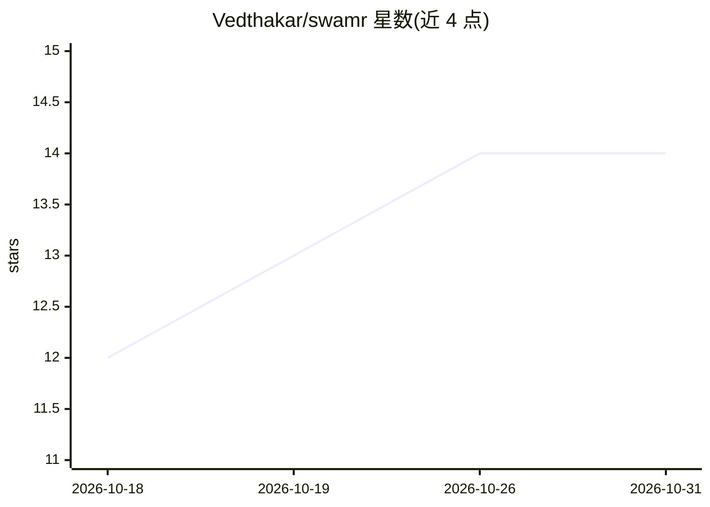

# Vedthakar/swamr

⭐ 14 · TypeScript · MIT · 推送 2026-10-05 · [GitHub](https://github.com/Vedthakar/swamr) · 个人维护

**用一条指令调度 150+ Cursor 专家 agent 并行构建项目的 CLI**

面向 Cursor 用户的 CLI 编排工具：一条提示词由首席架构 agent 规划，拆出 150+ 依赖感知的小任务，分派给前端、后端、安全等专家 agent（最多 20 个并发）分波并行执行；每波后运行类型检查、lint 与测试，由检查点 agent 生成修复任务。各 agent 通过共享 Obsidian vault 交换上下文，进度持久化到 state.json 可用 swamr continue 恢复。支持新项目（build）与接管现有代码库（adopt）。默认沙箱模式仅允许白名单命令，--trust 模式取消沙箱自动批准命令。自身无需 API key，复用已登录的 Cursor CLI；构建的应用使用托管 Supabase（无 Docker）。

## 筛选速览

| 维度 | 判定 | 备注 |
|---|---|---|
| AI 角色 | `ai-ecosystem` | LLM/agent 周边工具 |
| 许可风险 | `permissive` | MIT |
| 部署形态 | `library` | 以包/库形式分发 |
| 模型依赖 | — | README 未给出锁定关系 |
| 硬件要求 | — | 无带数字的原话,不猜 |
| 安装摩擦 | `low` | 无编译、无系统依赖或容器化 |
| 成熟度 | — | 结构信号不足 |

## 能力要点

- 150+ 专家 agent 分波并行执行，最多 20 个并发 cursor agent 进程
- 共享 Obsidian brain vault 保存跨 agent 决策与进度
- 每波自动运行类型检查/lint/测试并生成修复任务
- 默认沙箱+命令白名单，--trust 才解锁无人值守模式

## 适用场景

- 从一条提示词出发让 agent 团队并行搭建完整项目
- 接管现有代码库并自动完成剩余功能
- 需要中断后从保存状态恢复的长时间 agent 构建任务

## 场景标签

`多智能体` `编码 Agent` · 领域:Agent 开发

## 证据(README 行号)

> L5: **One prompt. A swarm of 150+ specialist Cursor agents plans, builds, tests, and hardens your whole project in paral
> L22: - 🐝 **Specialists build it in parallel.** Each task goes to the right expert (`@frontend-developer`, `@backend-arch
> L65: Every agent is a real, separate `cursor agent` process. They share the codebase through the filesystem and share co

## 星数曲线

2026-10-18 12 → 2026-10-31 14（+2）

---
*卡片 v1 · prompt 1.4 · 生成 2026-10-31 · 置信度 high · 依据 README sha `899c9c19a924` · [字段定义](../../DATASET.md)*
