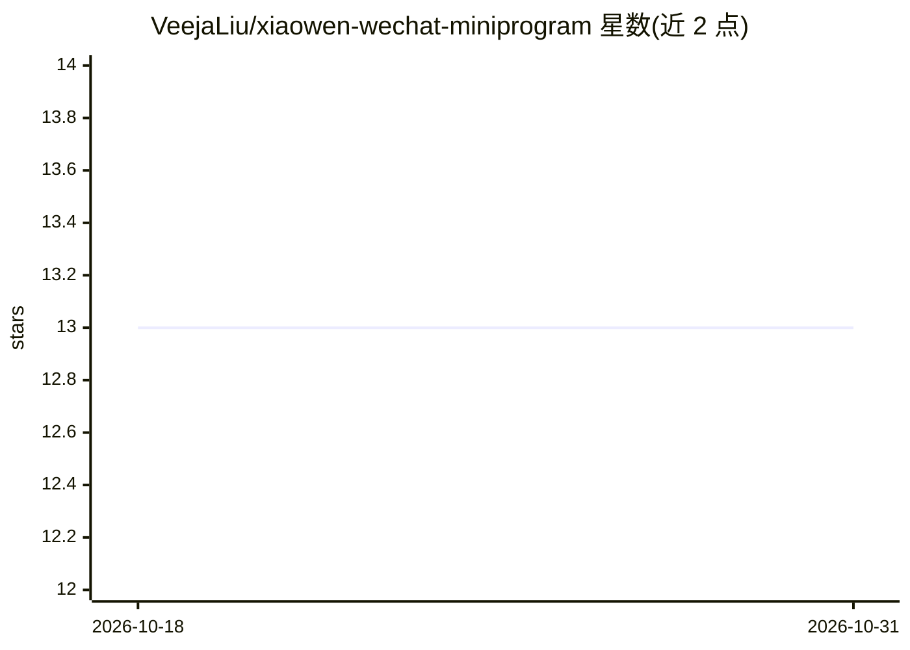

# VeejaLiu/xiaowen-wechat-miniprogram

⭐ 13 · Vue · 推送 2026-10-09 · [GitHub](https://github.com/VeejaLiu/xiaowen-wechat-miniprogram) · 个人维护 · 中文 README

**AI 生成纹身图案的微信小程序，多风格文生图与历史回顾**

面向纹身需求者的微信小程序：用户输入纹身描述并从点刺、纯黑、小清新、几何、日式等 10 种风格中选择，由 AI 生成纹身图案，支持结果预览与历史作品回顾。配套业务后端管理用户、生成额度、积分与生成任务，另有管理前端与纹身风格训练素材（Stable Diffusion 与 LoRA 训练数据）。通过邀请好友可获得更多生成额度。小程序采用 npm 安装依赖、微信开发者工具运行，需将后端地址配置到常量文件。

## 筛选速览

| 维度 | 判定 | 备注 |
|---|---|---|
| AI 角色 | `ai-native` | 本体是模型或模型工具 |
| 许可风险 | `none` | — |
| 部署形态 | `library` | 以包/库形式分发 |
| 模型依赖 | — | README 未给出锁定关系 |
| 硬件要求 | — | 无带数字的原话,不猜 |
| 安装摩擦 | `low` | 无编译、无系统依赖或容器化 |
| 成熟度 | — | 结构信号不足 |

## 能力要点

- 10 种纹身风格的文生图生成
- 生成额度、积分与邀请好友机制
- 历史作品回顾
- 仓库含小程序、后端、管理前端与 LoRA 训练素材四部分

## 适用场景

- 把自己的纹身想法生成为图案预览
- 对比不同纹身风格的生成效果
- 回顾和管理历史生成作品

## 场景标签

`图像生成` · 领域:内容生成

## 证据(README 行号)

> L7: 小纹 AI — 基于 AI 的纹身图案生成小程序。
> L9: 输入你想要的纹身描述，选择喜欢的风格，让 AI 帮你把想法变成图案。小纹 AI 提供点刺、纯黑、小清新、几何、日式等多种纹身风格，你可以查看生成结果、回顾历史作品，也可以通过邀请好友获得更多生成额度。
> L15: - 多种纹身图案风格选择（点刺、纯黑、小清新、几何线条、传统美式、新传统美式、日式、写实、垃圾波尔卡、图腾）

## 星数曲线

2026-10-18 13 → 2026-10-31 13（+0）

---
*卡片 v1 · prompt 1.4 · 生成 2026-10-31 · 置信度 high · 依据 README sha `08be69c3d693` · [字段定义](../../DATASET.md)*
