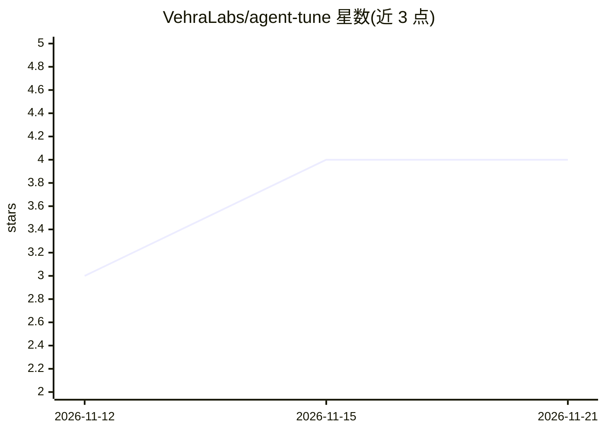

# VehraLabs/agent-tune

⭐ 4 · Python · MIT · 推送 2026-11-03 · [GitHub](https://github.com/VehraLabs/agent-tune) · 组织维护

**让 KTuner 车主借 AI 助手分析日志并改写调校文件**

面向已拥有 KTuner 硬件的 Honda 车主的 Python 命令行工具：读取 KTuner 导出的 CSV datalog，分析爆震、AFR、点火正时与燃油修正，并对 .kcl 调校文件中的具体表格单元格生成修改，写入新文件及变更清单。通过 skills 或 MCP 连接 Claude Code、Codex 等 AI 助手，也可完全脱离 AI 以命令方式使用每个功能。不直接刷写车辆、不改原始调校文件；目前仅在 64S ECU 上验证过调校文件编辑与直接记录。

## 筛选速览

| 维度 | 判定 | 备注 |
|---|---|---|
| AI 角色 | `ai-enhanced` | 去掉 AI 部分产品仍成立 |
| 许可风险 | `permissive` | MIT |
| 部署形态 | `library` | 以包/库形式分发 |
| 模型依赖 | locked-api |  |
| 硬件要求 | — | 无带数字的原话,不猜 |
| 安装摩擦 | `low` | 无编译、无系统依赖或容器化 |
| 成熟度 | — | 结构信号不足 |

## 能力要点

- 读取 KTuner datalog 并按调校师方式分析爆震、AFR、正时与燃油修正
- 对 .kcl 文件的 1,502 个值进行编辑，输出带逐值变更清单的新文件与 manifest
- 以 MCP 服务器或 agent skills 形式接入 AI 助手，所有命令均输出 JSON
- 不刷写车辆、不覆盖原始文件；改动需用户在 KTuner 中人工审核后自行刷写

## 适用场景

- 自己记录全油门日志，让 AI 助手建议点火与燃油表的改法
- 刷写前后对比两份 datalog，按 RPM 查看加速度与爆震变化
- 为新 ECU 校验 .kcl 文件布局并贡献验证数据

## 场景标签

 · 领域:汽车/ECU 调校工具

## 证据(README 行号)

> L37: * An AI assistant that can use skills or MCP, such as Claude Code or Codex. Optional:
> L64: |Anything that can run commands|Call `agent-tune` directly. Every command prints JSON.|

## 星数曲线

2026-11-12 3 → 2026-11-21 4（+1）

---
*卡片 v1 · prompt 1.4 · 生成 2026-11-21 · 置信度 high · 依据 README sha `ff21c0144c8e` · [字段定义](../../DATASET.md)*
