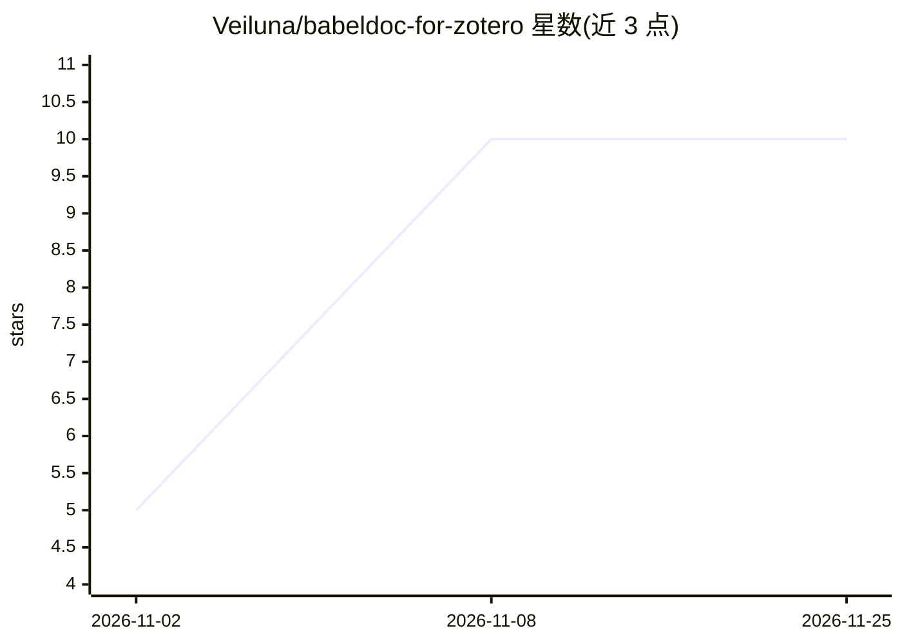

# Veiluna/babeldoc-for-zotero

⭐ 10 · Python · AGPL-3.0 · 推送 2026-11-03 · [GitHub](https://github.com/Veiluna/babeldoc-for-zotero) · [官网](https://github.com/Veiluna/babeldoc-for-zotero/releases/latest) · 个人维护 · 中文 README

**Zotero 插件：一键将外文 PDF 翻译成保持版式的中文/双语 PDF**

面向 Zotero 7–10（Windows）用户的 PDF 翻译插件，基于开源 BabelDOC 引擎：右键即可把 PDF 翻译成保持原版式的简体中文 PDF，或生成左右分栏中英对照 PDF；图内可编辑文字、链接跳转一并处理，译本作为新附件导入且不改动原 PDF。用户自行填写 OpenAI 兼容接口地址、API key 与模型名调用翻译模型。插件首次启动自动下载独立 Python 3.12 环境与 BabelDOC；仅支持单栏/对称双栏版式，表格内文字与图片 OCR 不翻译。

## 筛选速览

| 维度 | 判定 | 备注 |
|---|---|---|
| AI 角色 | `ai-native` | 本体是模型或模型工具 |
| 许可风险 | `viral` | AGPL-3.0 |
| 部署形态 | `None` |  |
| 模型依赖 | — | README 未给出锁定关系 |
| 硬件要求 | — | 无带数字的原话,不猜 |
| 安装摩擦 | `low` | 无编译、无系统依赖或容器化 |
| 成熟度 | — | 结构信号不足 |

## 能力要点

- 保持原版式的中文 PDF 与分栏中英对照 PDF 两种输出
- 基于 BabelDOC，支持图内可编辑文字与链接保留
- 整篇文档合并为尽量少的 API 请求，适配有次数限制的接口
- 首次启动自动安装 Python 环境与 BabelDOC，无需手动配置

## 适用场景

- 在 Zotero 文献库里批量把英文论文翻成中文阅读
- 生成中英对照 PDF 做精读与划词对照
- 通过自有的 OpenAI 兼容接口控制翻译成本

## 场景标签

`科研工具` · 领域:学习与行业

## 证据(README 行号)

> L9: 在 Zotero 里一键把外文 PDF 翻译成**保持原版式的简体中文 PDF**，也可以生成**分栏中英对照 PDF**。翻译引擎是开源的 BabelDOC，模型用你自己的 OpenAI 兼容接口（填写接口地址、API key 和
> L29: - 一个 OpenAI 兼容的 Chat Completions 接口、API key 和模型名。模型需要支持单次输出 50000 token。

## 星数曲线

2026-11-02 5 → 2026-11-25 10（+5）

---
*卡片 v1 · prompt 1.4 · 生成 2026-11-20 · 置信度 high · 依据 README sha `3f2c024ea12d` · [字段定义](../../DATASET.md)*
