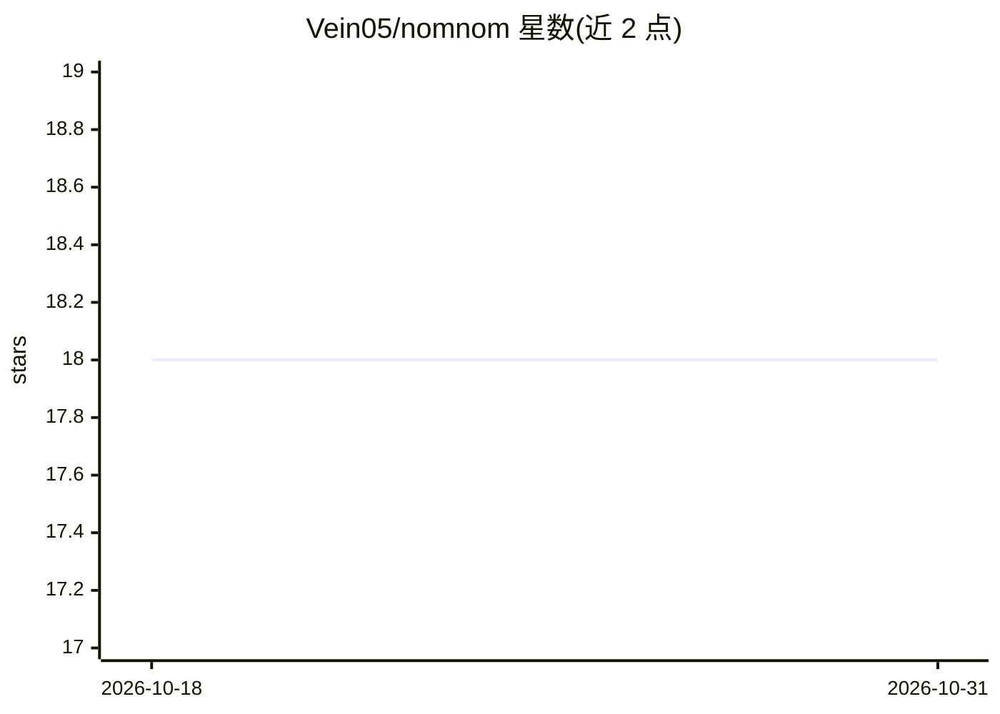

# Vein05/nomnom

⭐ 18 · Go · MIT · 推送 2026-06-01 · [GitHub](https://github.com/Vein05/nomnom) · 个人维护

**用 AI 批量重命名与整理文件的桌面应用与 CLI**

基于 Wails + Go 的桌面应用及共享后端的 CLI：扫描目录，读取文本、图片、音频元数据等文件内容，调用所选 AI 提供商生成一致的重命名建议，可预览、应用或复制到输出目录，CLI 支持从本地历史回滚会话。提供商支持 OpenRouter、DeepSeek 与本地 Ollama，图像重命名依赖多模态模型。桌面版提供 macOS/Windows 安装包（Windows 未测试），CLI 经 Homebrew 或二进制分发，支持四种平台。

## 筛选速览

| 维度 | 判定 | 备注 |
|---|---|---|
| AI 角色 | `ai-native` | 本体是模型或模型工具 |
| 许可风险 | `permissive` | MIT |
| 部署形态 | `desktop` | 安装包/桌面程序 |
| 模型依赖 | local-ok | 支持本地模型 |
| 硬件要求 | — | 无带数字的原话,不猜 |
| 安装摩擦 | `low` | 无编译、无系统依赖或容器化 |
| 成熟度 | — | 结构信号不足 |

## 能力要点

- AI 根据文件内容（文本/图片/音频元数据等）生成重命名建议
- 支持 OpenRouter、DeepSeek、本地 Ollama 三种提供商
- 预览后应用或复制到输出目录，CLI 可回滚历史会话
- 桌面应用与 CLI 共享同一 Go 后端

## 适用场景

- 批量整理命名混乱的照片、文档和音频文件
- 在应用重命名前预览 AI 建议并选择性执行
- 用本地 Ollama 离线完成 AI 重命名

## 场景标签

 · 领域:文件管理/桌面工具

## 证据(README 行号)

> L19: NomNom is a desktop app that renames your files using AI. Point it at a folder, and it generates clean, consistent 
> L22: - **AI naming** generates rename suggestions using your provider of choice

## 星数曲线

2026-10-18 18 → 2026-10-31 18（+0）

---
*卡片 v1 · prompt 1.4 · 生成 2026-10-29 · 置信度 high · 依据 README sha `ba4ad8183d76` · [字段定义](../../DATASET.md)*
