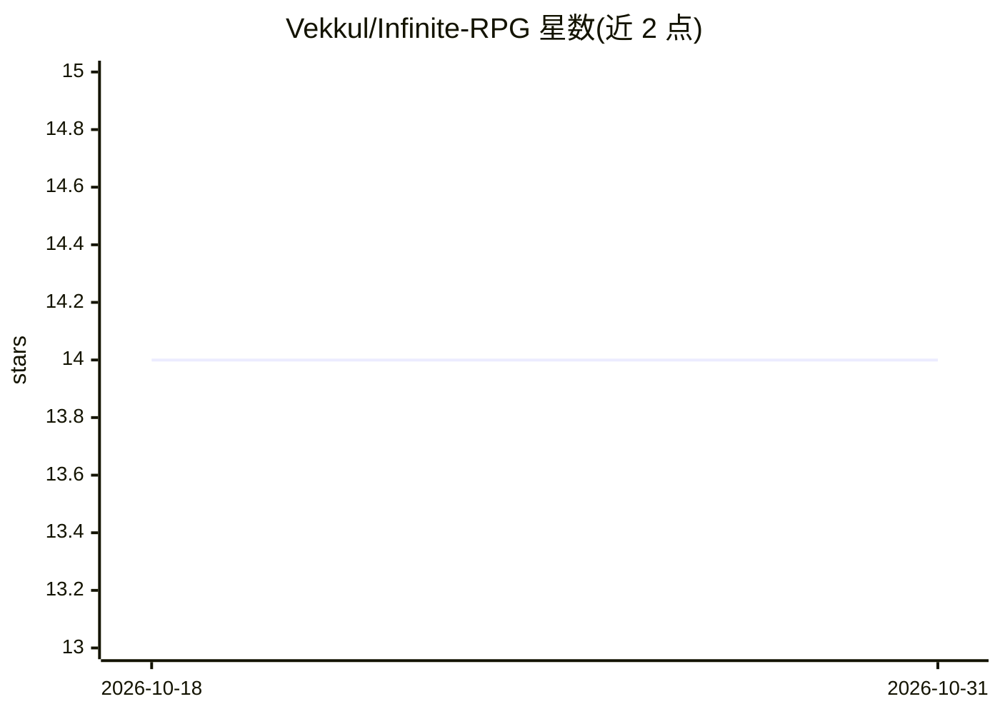

# Vekkul/Infinite-RPG

⭐ 14 · TypeScript · 推送 2026-04-11 · [GitHub](https://github.com/Vekkul/Infinite-RPG) · [官网](https://ai.studio/apps/69cade97-8fd3-4bb2-94eb-dd011e82cb49) · 个人维护

**基于 Gemini 程序化生成的无限文字 RPG，浏览器中游玩**

在浏览器中运行的回合制文字 RPG：世界地图、地点描述、怪物、社交事件与剧情均由 Google Gemini API 实时生成；Journal 系统以任务与叙事标记追踪玩家行为的长期后果。支持自定义职业与属性、AI 生成 16-bit 像素头像、Gemini TTS 语音旁白、合成系统与 IndexedDB 本地存档。技术栈为 React + TypeScript + Tailwind CSS，游戏逻辑使用 gemini-3-flash-preview，图像与地图使用 gemini-2.5-flash-image，语音使用 gemini-2.5-flash-preview-tts。README 未给出安装或运行方式，定位为 LLM 生成动态游戏内容的演示项目。

## 筛选速览

| 维度 | 判定 | 备注 |
|---|---|---|
| AI 角色 | `ai-native` | 本体是模型或模型工具 |
| 许可风险 | `none` | — |
| 部署形态 | `None` |  |
| 模型依赖 | — | README 未给出锁定关系 |
| 硬件要求 | — | 无带数字的原话,不猜 |
| 安装摩擦 | `low` | 无编译、无系统依赖或容器化 |
| 成熟度 | — | 结构信号不足 |

## 能力要点

- 世界地图、描述、怪物与事件由 Gemini API 程序化生成
- Journal 系统记录任务与叙事标记，玩家选择产生长期后果
- AI 生成 16-bit 像素角色头像与 Gemini TTS 语音旁白
- IndexedDB 本地保存游戏进度与生成资产

## 适用场景

- 游玩每次都不同的 AI 生成文字冒险
- 体验 LLM 驱动的程序化游戏内容生成方式
- 通过自定义职业、属性与即兴行动进行角色扮演

## 场景标签

 · 领域:游戏/互动叙事

## 证据(README 行号)

> L3: Embark on a never-ending adventure in a world crafted by AI. Explore, battle, and become a legend in an RPG that's d
> L71: * **AI/Content Generation**: Google Gemini API
> L76: This project serves as a demonstration of how to leverage a powerful Large Language Model (LLM) to create dynamic, 

## 星数曲线

2026-10-18 14 → 2026-10-31 14（+0）

---
*卡片 v1 · prompt 1.4 · 生成 2026-10-31 · 置信度 high · 依据 README sha `24e91bc78959` · [字段定义](../../DATASET.md)*
