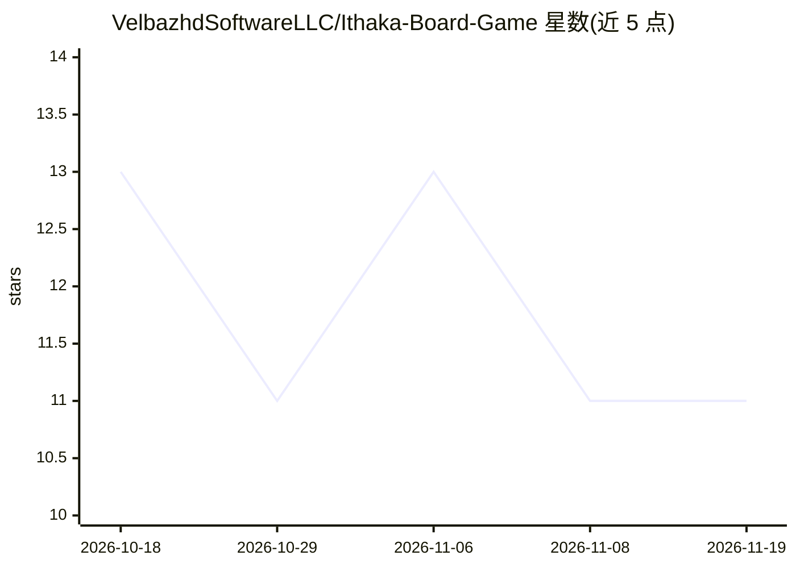

# VelbazhdSoftwareLLC/Ithaka-Board-Game

⭐ 11 · Java · GPL-3.0 · 推送 2026-05-08 · [GitHub](https://github.com/VelbazhdSoftwareLLC/Ithaka-Board-Game) · [官网](https://play.google.com/store/apps/details?id=eu.veldsoft.ithaka.board.game) · 组织维护

**Ithaka 棋盘游戏实现，含 AI 对弈引擎**

按 Ithaka 规则实现的棋盘游戏：4×4 网格、四种颜色各三枚棋子，双方共用棋子，按正交或对角线直线移动，以三子连珠或使对手无子可动获胜。仓库主题标签涉及蒙特卡洛树搜索、蒙特卡洛模拟、暴力搜索与人工神经网络，表明包含对弈 AI 引擎。以 Java 实现，提供 F-Droid 与 Google Play 渠道获取。

## 筛选速览

| 维度 | 判定 | 备注 |
|---|---|---|
| AI 角色 | `ai-native` | 本体是模型或模型工具 |
| 许可风险 | `viral` | GPL-3.0 |
| 部署形态 | `None` |  |
| 模型依赖 | — | README 未给出锁定关系 |
| 硬件要求 | — | 无带数字的原话,不猜 |
| 安装摩擦 | `low` | 无编译、无系统依赖或容器化 |
| 成熟度 | — | 结构信号不足 |

## 能力要点

- 实现 Ithaka 抽象棋盘游戏完整规则（直线移动、共用棋子）
- 主题标签包含蒙特卡洛树搜索与人工神经网络等 AI 算法
- Java 实现并带代码质量与构建状态徽章

## 适用场景

- 在手机上玩 Ithaka 棋盘游戏
- 与基于搜索算法的 AI 对手对弈
- 研究棋类游戏的蒙特卡洛树搜索实现

## 场景标签

 · 领域:游戏/棋盘游戏

## 证据(README 行号)

> L17: Ithaka board game is played on a four by four square grid with three pieces in each of four colors. The pieces are 
> L29: Get it on F-Droid

## 星数曲线

2026-10-18 13 → 2026-11-19 11（-2）

---
*卡片 v1 · prompt 1.4 · 生成 2026-11-18 · 置信度 mid · 依据 README sha `3c4a351636d3` · [字段定义](../../DATASET.md)*
