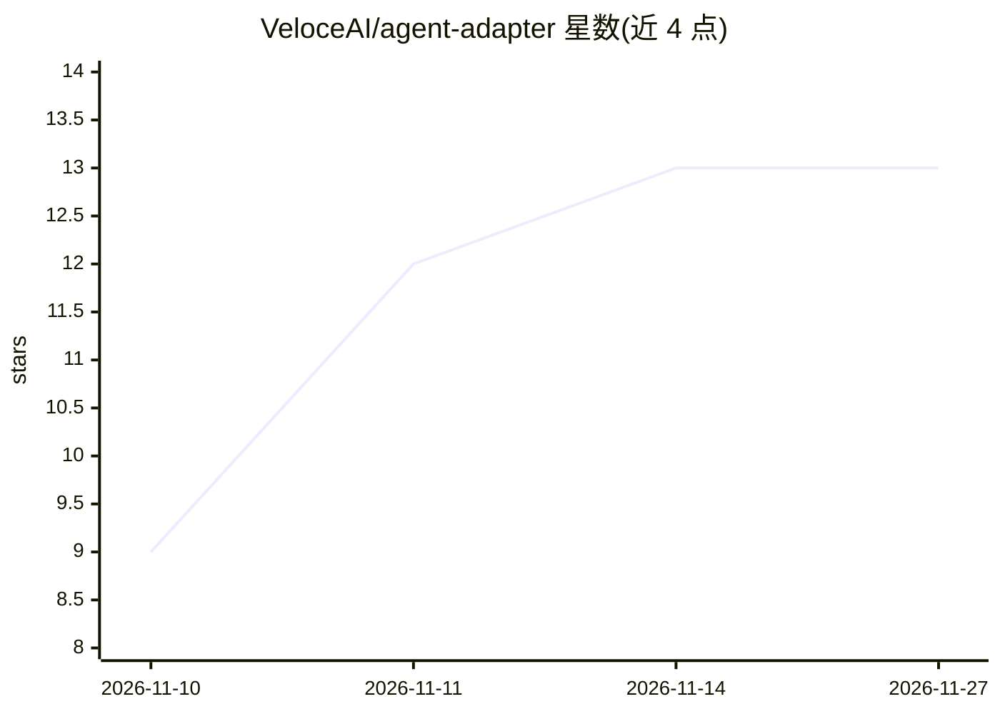

# VeloceAI/agent-adapter

⭐ 13 · Python · Apache-2.0 · 推送 2026-11-18 · [GitHub](https://github.com/VeloceAI/agent-adapter) · [官网](https://agent-adapter.veloceai.in) · 组织维护

**让工具写一次即可在多 agent 框架安全运行的 Python SDK**

框架无关的 Python SDK：把普通函数转为 LLM 工具，启动时校验 schema，所有调用经统一执行器处理审批、预算、守卫、缓存与成本记录。核心仅依赖 pydantic，各框架支持为可选 extra。支持无框架直接使用（FastAPI 服务）或以 run_tool_loop/Flow 作为自身 agent 循环与图编排。需 Python 3.11+，Apache-2.0 许可。提供本地 viewer/chat、审计日志与 eval 功能。

## 筛选速览

| 维度 | 判定 | 备注 |
|---|---|---|
| AI 角色 | `ai-ecosystem` | LLM/agent 周边工具 |
| 许可风险 | `permissive` | Apache-2.0 |
| 部署形态 | `library` | 以包/库形式分发 |
| 模型依赖 | locked-api |  |
| 硬件要求 | — | 无带数字的原话,不猜 |
| 安装摩擦 | `low` | 无编译、无系统依赖或容器化 |
| 成熟度 | — | 结构信号不足 |

## 能力要点

- 一次编写的工具可在 21 个框架与引擎中运行
- 执行器统一提供一次性审批、预算、守卫、缓存与成本账本
- 签名的哈希链审计日志与 YAML/TOML/JSON 策略文件
- Flow 图可编译到 LangGraph 与 ADK

## 适用场景

- 在多个 agent 框架间复用同一套工具定义
- 为 agent 的风险操作加人工审批与花费上限
- 统一记录与核算各框架 agent 调用的成本

## 场景标签

`Agent 框架` · 领域:Agent 开发

## 证据(README 行号)

> L20: It is an open-source, framework-independent Python SDK. It turns your functions into LLM
> L176: |an agent framework|one module and one extra per framework (LangGraph, ADK, LangChain, MCP, OpenAI Agents SDK, Pyd

## 星数曲线

2026-11-10 9 → 2026-11-27 13（+4）

---
*卡片 v1 · prompt 1.4 · 生成 2026-11-18 · 置信度 high · 依据 README sha `b21b543cd647` · [字段定义](../../DATASET.md)*
