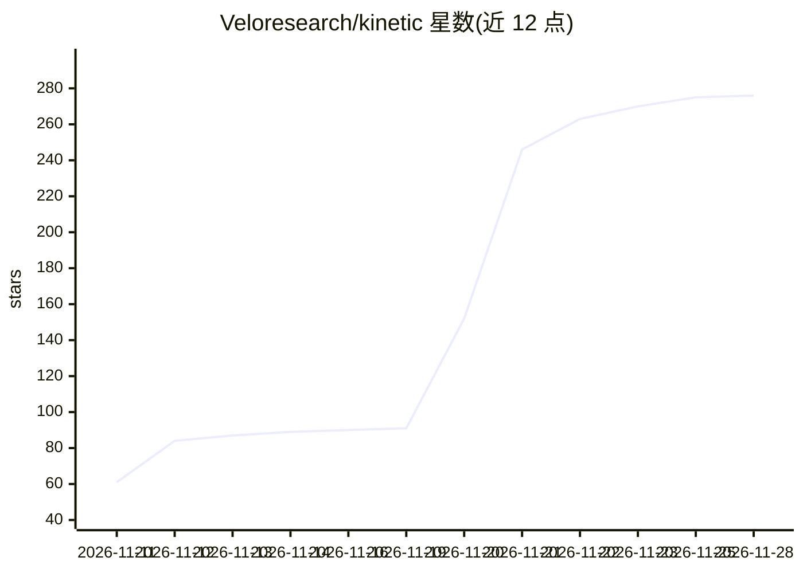

# Veloresearch/kinetic

⭐ 276 · Rust · Apache-2.0 · 推送 2026-11-27 · [GitHub](https://github.com/Veloresearch/kinetic) · [官网](https://veloresearch.com/research/kinetic) · 组织维护

**本地运行 GGUF 模型的 Rust 推理引擎，供本机使用**

Rust 编写的本地推理引擎，读取 GGUF 文件并在 CPU 与 NVIDIA/AMD/Intel/Apple GPU 上运行模型，单个二进制覆盖 Windows/Linux/macOS。提供 kinetic pull/chat/serve/run/bench 等命令、终端主屏界面与 OpenAI 风格 API（端口 8080）。宣称推理速度提升不改变输出（RAD-1 精确投机解码、Warm Start、Zero Wait、Torque、Convoy 等技术默认开启）。当前为 beta（0.1.x），0.2 目标是支持 llama.cpp 能跑的所有热门模型；部分模型仅在 CPU 上运行，Inkling 2 暂无图像输入。

## 筛选速览

| 维度 | 判定 | 备注 |
|---|---|---|
| AI 角色 | `ai-ecosystem` | LLM/agent 周边工具 |
| 许可风险 | `permissive` | Apache-2.0 |
| 部署形态 | `desktop` | 安装包/桌面程序 |
| 模型依赖 | local-ok | 支持本地模型 |
| 硬件要求 | `cpu-ok` | |
| 安装摩擦 | `low` | 无编译、无系统依赖或容器化 |
| 成熟度 | `idea` | |

## 能力要点

- 单二进制支持 CPU 与 NVIDIA/AMD/Intel/Apple GPU（CUDA/Vulkan/Metal）
- 精确投机解码 RAD-1 与 Warm Start/Zero Wait/Torque/Convoy 等加速技术，宣称不改变输出 token
- 可运行 Ollama、LM Studio 与 Hugging Face 缓存中已有的 GGUF 模型
- 提供 llama-server/cli/bench/quantize/perplexity 的对应替代命令与兼容 flags

## 适用场景

- 在本地电脑上通过命令行拉取模型并对话
- 用 kinetic serve 在 8080 端口提供 API 给应用调用
- 复用已有的 GGUF 文件与 Ollama/LM Studio 模型缓存
- 对本地推理做基准测试（kinetic bench）

## 场景标签

`推理引擎` · 领域:训练与推理

## 证据(README 行号)

> L3: ### The open engine for running AI on your own computer.
> L5: Written in Rust. It reads GGUF files, the format llama.cpp uses, and runs the models it
> L59: **0.2 is the release where Kinetic runs every popular model llama.cpp runs.** The map shows where we are.

## 星数曲线

2026-11-11 61 → 2026-11-28 276（+215）

---
*卡片 v1 · prompt 1.4 · 生成 2026-11-28 · 置信度 high · 依据 README sha `a2b3c24641b7` · [字段定义](../../DATASET.md)*
