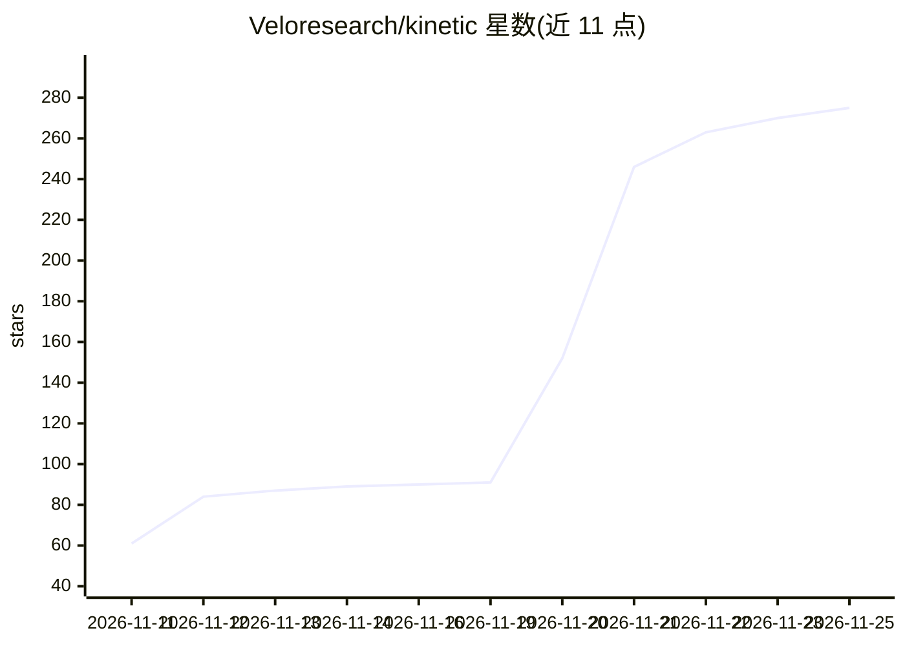

# Veloresearch/kinetic

⭐ 275 · Rust · Apache-2.0 · 推送 2026-11-23 · [GitHub](https://github.com/Veloresearch/kinetic) · [官网](https://veloresearch.com/research/kinetic) · 组织维护

**本地运行 GGUF 模型的推理引擎：CPU 与 NVIDIA/AMD/Intel GPU**

Rust 编写的本地 LLM 推理引擎，读取 llama.cpp 使用的 GGUF 格式，单个二进制同时支持 CPU 与 NVIDIA（CUDA）、AMD/Intel（Vulkan）GPU。提供 pull/chat/serve/run/quantize/perplexity/bench 等子命令，serve 端口同时提供 OpenAI API、llama-server API 与 Ollama API。内置 RAD-1 投机解码、Warm Start 缓存、Zero Wait 边输入边处理等加速技术，并声明输出与普通解码逐 token 一致。当前为 0.1 beta，仅支持 Windows/Linux x86-64，模型在 GPU/CPU 分层时同一答案的确定性尚待 0.2 修复。

## 筛选速览

| 维度 | 判定 | 备注 |
|---|---|---|
| AI 角色 | `ai-ecosystem` | LLM/agent 周边工具 |
| 许可风险 | `permissive` | Apache-2.0 |
| 部署形态 | `desktop` | 安装包/桌面程序 |
| 模型依赖 | local-ok | 支持本地模型 |
| 硬件要求 | `cpu-ok` | |
| 安装摩擦 | `low` | 无编译、无系统依赖或容器化 |
| 成熟度 | `idea` | |

## 能力要点

- 单个二进制支持 CPU、CUDA 与 Vulkan，GGUF 文件直接运行
- serve 端口同时兼容 OpenAI API、llama-server API 与 Ollama API
- 内置投机解码（RAD-1）、Warm Start、Zero Wait、Torque、Convoy 等加速机制，可经 --off 逐项关闭
- 可列出 Ollama、LM Studio 与 Hugging Face 缓存中已有模型并按名运行

## 适用场景

- 在自己的电脑上用命令行下载并对话本地 GGUF 模型
- 以 OpenAI 兼容接口在本地起服务供客户端调用
- 从 llama.cpp 工具链（llama-server/llama-cli/llama-quantize 等）迁移命令
- 量化 GGUF 模型并测量困惑度

## 场景标签

`推理引擎` `模型量化` · 领域:训练与推理

## 证据(README 行号)

> L3: ### The open engine for running AI on your own computer.
> L5: Written in Rust. It reads GGUF files, the format llama.cpp uses, and runs the models it
> L294: works as written. One port answers the OpenAI API under `/v1`,

## 星数曲线

2026-11-11 61 → 2026-11-25 275（+214）

---
*卡片 v1 · prompt 1.4 · 生成 2026-11-25 · 置信度 high · 依据 README sha `9f83c28c1913` · [字段定义](../../DATASET.md)*
