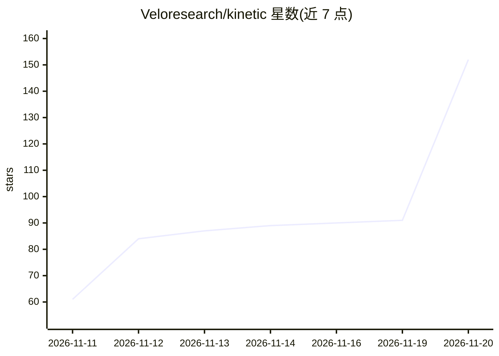

# Veloresearch/kinetic

⭐ 152 · Rust · Apache-2.0 · 推送 2026-11-19 · [GitHub](https://github.com/Veloresearch/kinetic) · [官网](https://veloresearch.com/research/kinetic) · 组织维护

**本地运行 GGUF 模型的开源推理引擎，单一二进制跨 CPU/GPU**

用 Rust 编写的本地 LLM 推理引擎：读取 llama.cpp 的 GGUF 格式，在 CPU 及 NVIDIA/AMD/Intel GPU 上运行模型，单一二进制覆盖 chat/run/serve/quantize/perplexity 等命令。加速手段包括精确投机解码（RAD-1）、Warm Start 状态复用、Zero Wait 预填充、CUDA 图重放、批量共享等，声明输出与普通解码逐 token 一致。提供 OpenAI API 与 llama-server/Ollama 兼容端点，可替代 llama.cpp 系列工具。当前为 0.1.0 Beta 1，存在若干已知问题（如部分 IQ 量化仅限 CPU、Apple Silicon 需自行编译）。

## 筛选速览

| 维度 | 判定 | 备注 |
|---|---|---|
| AI 角色 | `ai-ecosystem` | LLM/agent 周边工具 |
| 许可风险 | `permissive` | Apache-2.0 |
| 部署形态 | `desktop` | 安装包/桌面程序 |
| 模型依赖 | local-ok | 支持本地模型 |
| 硬件要求 | — | 无带数字的原话,不猜 |
| 安装摩擦 | `low` | 无编译、无系统依赖或容器化 |
| 成熟度 | `idea` | |

## 能力要点

- 单一二进制支持 CPU 与 NVIDIA/AMD/Intel GPU（CUDA/Vulkan）
- RAD-1 精确投机解码、Warm Start、Zero Wait 等默认开启的加速机制
- OpenAI API、llama-server API 与 Ollama API 兼容端点
- kinetic models 可发现 Ollama、LM Studio 与 Hugging Face 缓存中的模型

## 适用场景

- 在个人电脑上本地运行 GGUF 格式的 LLM 并对话
- 从 llama-server/Ollama 迁移，保留现有客户端与 GGUF 文件
- 通过本地 OpenAI 兼容接口为其他应用提供推理服务

## 场景标签

`推理引擎` · 领域:训练与推理

## 证据(README 行号)

> L3: ### The open engine for running AI on your own computer.
> L5: Written in Rust. It reads GGUF files, the format llama.cpp uses, and runs the models it
> L259: Your GGUF files work unchanged when their model family is supported, and one binary stands in for `llama-server`,

## 星数曲线

2026-11-11 61 → 2026-11-20 152（+91）

---
*卡片 v1 · prompt 1.4 · 生成 2026-11-17 · 置信度 high · 依据 README sha `41addfce78e1` · [字段定义](../../DATASET.md)*
