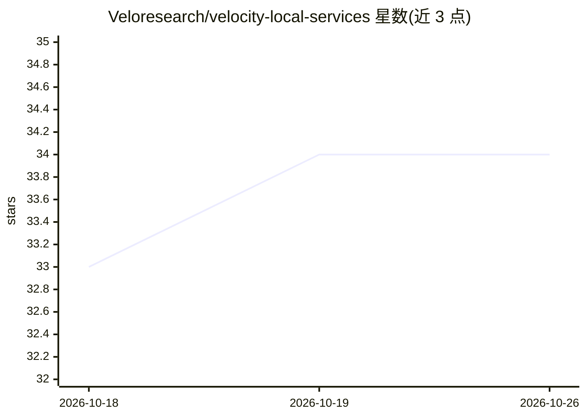

# Veloresearch/velocity-local-services

⭐ 34 · NOASSERTION · 推送 2026-10-25 · [GitHub](https://github.com/Veloresearch/velocity-local-services) · [官网](https://veloresearch.com/vls) · 组织维护

**本地运行 GGUF 模型的桌面应用：聊天、语音、电脑操作与 OpenAI 兼容 API**

面向终端用户的本地 LLM 运行应用：加载任意 GGUF 模型，VLS 按显卡自动选择 CUDA/Vulkan/CPU 构建运行。提供带网络搜索与来源引用的聊天、语音输入与实时转写、Python 沙箱、电路原理图绘制，以及模型操作电脑（目前仅 Windows，四级权限）。Velocity Context 机制支持最高 32M token 的长上下文（自称非 RAG、无嵌入模型与向量库）。同时对外提供 OpenAI 兼容 API 与 MCP，可接入 opencode、Hermes Agent 等应用。无账户、无遥测、无 Docker，Windows/Linux 提供安装程序。当前为 0.1.1 Preview 版，Windows 安装包未代码签名。

## 筛选速览

| 维度 | 判定 | 备注 |
|---|---|---|
| AI 角色 | `ai-native` | 本体是模型或模型工具 |
| 许可风险 | `none` | NOASSERTION |
| 部署形态 | `desktop` | 安装包/桌面程序 |
| 模型依赖 | local-ok | 支持本地模型 |
| 硬件要求 | — | 无带数字的原话,不猜 |
| 安装摩擦 | `medium` | 含编译或系统依赖之一 |
| 成熟度 | `idea` | |

## 能力要点

- 加载任意 GGUF 模型，安装器自动选择 CUDA/Vulkan/CPU 构建
- Velocity Context 长上下文，自称最高 32M token，回答附 receipt
- OpenAI 兼容 API 与 MCP 服务，供 opencode/Hermes 等应用接入
- 电脑操作（computer use，仅 Windows）与四级权限控制、活动日志

## 适用场景

- 在本机私密地与本地模型聊天、搜索并引用来源
- 让本地模型按权限代为操作电脑完成任务
- 把本地模型作为 OpenAI 兼容 API 提供给其他工具使用

## 场景标签

`AI 助手` `GUI 自动化` `语音识别` `推理引擎` · 领域:效率与自动化

## 证据(README 行号)

> L7: One app to load any GGUF model and work with it: chat with web search and tools, voice,
> L8: pictures, computer use - and an OpenAI-compatible API and MCP for every other app you use.
> L53: - **One app for running models locally.** Download or add a GGUF model, and VLS picks how it runs on your graphics 

## 星数曲线

2026-10-18 33 → 2026-10-26 34（+1）

---
*卡片 v1 · prompt 1.4 · 生成 2026-10-25 · 置信度 mid · 依据 README sha `1de94eec33b3` · [字段定义](../../DATASET.md)*
