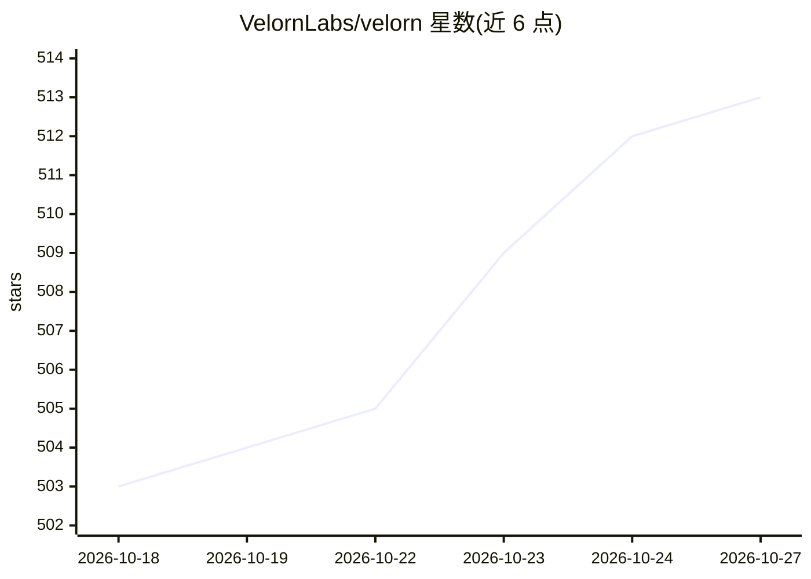

# VelornLabs/velorn

⭐ 513 · JavaScript · GPL-3.0 · 推送 2026-10-12 · [GitHub](https://github.com/VelornLabs/velorn) · [官网](https://velorn.ai) · 组织维护

**开源桌面 AI 视频工作站：时间线剪辑 + ComfyUI 生成 + 100+ MCP 工具**

基于 Electron 的开源桌面视频编辑器与 AI 视频工作站，GPL-3.0 许可，提供 Windows/macOS/Linux 安装包。编辑、字幕、导出、项目管理与 MCP 编辑工具可在无 ComfyUI 情况下独立使用；所有生成功能依赖本机运行的 ComfyUI 实例（默认 127.0.0.1:8188），支持导入自定义 ComfyUI API workflow JSON 与 Bridge 回传。内置本地 MCP 服务器提供 100+ 工具供 Claude Code、Cursor 等 agent 客户端操作时间线、排队生成任务与导出。重型视频工作流可能需要 24GB+ 显存，云端工作流需 Comfy.org 凭据与积分。

## 筛选速览

| 维度 | 判定 | 备注 |
|---|---|---|
| AI 角色 | `ai-enhanced` | 去掉 AI 部分产品仍成立 |
| 许可风险 | `viral` | GPL-3.0 |
| 部署形态 | `desktop` | 安装包/桌面程序 |
| 模型依赖 | — | README 未给出锁定关系 |
| 硬件要求 | — | 无带数字的原话,不猜 |
| 安装摩擦 | `low` | 无编译、无系统依赖或容器化 |
| 成熟度 | — | 结构信号不足 |

## 能力要点

- 多轨道时间线编辑、字幕样式、代理/缓存与导出面板
- 对接本地 ComfyUI 运行本地/云端/自定义图像与视频生成工作流
- 本地 MCP 服务器提供 100+ 工具，供 Claude Code/Cursor 等 agent 操作项目
- 引导式创作流：音乐视频、UGC 广告、商业广告、短片（beta）

## 适用场景

- 用本地 ComfyUI 工作流生成素材并在同一应用内完成剪辑与导出
- 让 Claude Code 等 agent 通过 MCP 生成媒体、搭建时间线并混音
- 从歌词与角色设定制作音乐视频，逐镜头生成关键帧与视频

## 场景标签

`视频生成` `图像生成` `图像视频处理` · 领域:内容生成

## 证据(README 行号)

> L26: Editing, captions, export, project management, and MCP editorial tools work without ComfyUI. All current generation
> L41: For generation, Velorn is not a replacement for ComfyUI. It is the production layer around ComfyUI: plan the work, 

## 星数曲线

2026-10-18 503 → 2026-10-27 513（+10）

---
*卡片 v1 · prompt 1.4 · 生成 2026-10-21 · 置信度 high · 依据 README sha `6d549559953b` · [字段定义](../../DATASET.md)*
