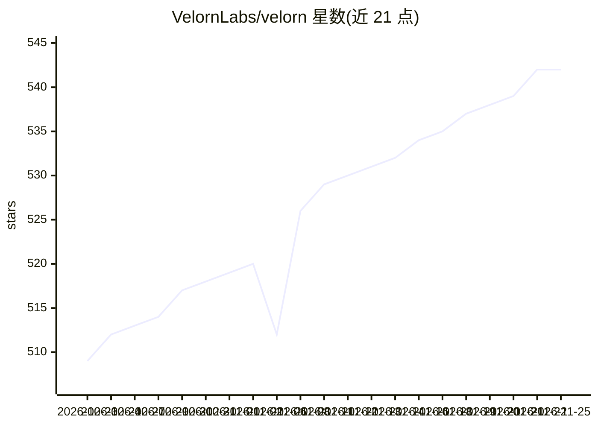

# VelornLabs/velorn

⭐ 542 · JavaScript · GPL-3.0 · 推送 2026-11-23 · [GitHub](https://github.com/VelornLabs/velorn) · [官网](https://velorn.ai) · 组织维护 · 中文 README

**面向创作者与 agent 的开源 AI 视频工作站与时间线编辑器**

桌面端视频编辑器，将规划、媒体生成、素材管理、时间线剪辑、字幕、特效与导出整合为项目制应用。剪辑、字幕、导出与 MCP 工具无需 ComfyUI 即可使用；图片、视频、语音与音效生成通过 Comfy Router 云服务（需自有 key 与额度），本地模型与自定义工作流依赖本机 ComfyUI 实例。内置 Velo 助手可回答项目问题并执行编辑，本地 MCP 服务器提供 100+ 工具供 Claude Code、Cursor 等 MCP 客户端控制时间线、排队生成与导出。Windows/macOS/Linux 提供安装包。

## 筛选速览

| 维度 | 判定 | 备注 |
|---|---|---|
| AI 角色 | `ai-native` | 本体是模型或模型工具 |
| 许可风险 | `viral` | GPL-3.0 |
| 部署形态 | `desktop` | 安装包/桌面程序 |
| 模型依赖 | — | README 未给出锁定关系 |
| 硬件要求 | — | 无带数字的原话,不猜 |
| 安装摩擦 | `low` | 无编译、无系统依赖或容器化 |
| 成熟度 | — | 结构信号不足 |

## 能力要点

- 100+ 工具的本地 MCP 服务器，支持 Codex/Claude Code/Cursor 兼容客户端
- 内置 Director 引导式工作流：MV 制作、UGC 广告、商家广告、短片
- 多轨时间线剪辑、字幕生成与硬件加速导出
- 支持本地 ComfyUI、Comfy Router 云服务与自定义 API 工作流 JSON 导入

## 适用场景

- 用歌词、角色、关键帧生成并剪辑音乐视频
- 制作 UGC 风格创作者广告与小微企业广告
- 让 MCP agent 代为审查时间线、安装工作流并执行导出
- 在项目内管理生成素材、提示词与工作流输出

## 场景标签

`图像生成` `视频生成` · 领域:内容生成

## 证据(README 行号)

> L24: Velorn is an open-source desktop video editor and AI video workstation. It brings planning, generation, asset manag
> L187: Velorn includes a local MCP server with 100+ tools for Codex, Claude Code, Cursor-compatible tools, and other MCP 

## 星数曲线

2026-10-23 509 → 2026-11-25 542（+33）

---
*卡片 v1 · prompt 1.4 · 生成 2026-11-25 · 置信度 mid · 依据 README sha `6d196ce55bee` · [字段定义](../../DATASET.md)*
