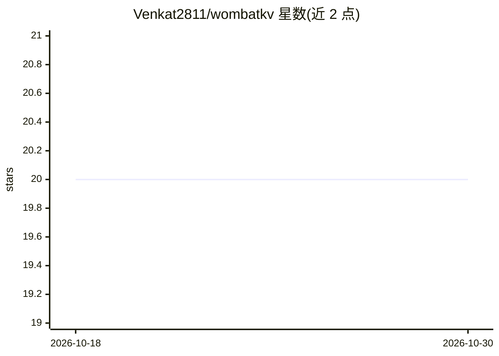

# Venkat2811/wombatkv

⭐ 20 · Rust · Apache-2.0 · 推送 2026-08-10 · [GitHub](https://github.com/Venkat2811/wombatkv) · [官网](https://docs.rs/wombatkv-node) · 个人维护

**面向 LLM 推理的对象存储原生 KV cache 系统**

WombatKV 将 LLM 推理的 KV cache 以内容寻址块形式存入 S3 兼容对象存储（AWS S3、MinIO、Cloudflare R2、GCS），使 prefill 结果可跨重启、跨会话、跨引擎、跨机器复用，无需引擎 ID 或协调机制。提供 embedded（C ABI 进程内）与 daemon（独立进程 sidecar）两种模式，以 Rust crates、C 库与 daemon 二进制交付。0.1.0-alpha 阶段仅有 ds4（DeepSeek-V4-Flash）适配器，在 M3 Max 上验证；README 声明不推荐生产部署。vLLM、llama.cpp、Ollama 等引擎集成为未完成路线图项。

## 筛选速览

| 维度 | 判定 | 备注 |
|---|---|---|
| AI 角色 | `ai-ecosystem` | LLM/agent 周边工具 |
| 许可风险 | `permissive` | Apache-2.0 |
| 部署形态 | `self-host` | docker 或自建部署 |
| 模型依赖 | locked-api |  |
| 硬件要求 | — | 无带数字的原话,不猜 |
| 安装摩擦 | `low` | 无编译、无系统依赖或容器化 |
| 成熟度 | `idea` | |

## 能力要点

- KV 块内容寻址（BLAKE3 over model+tokenizer+dtype+LoRA+prefix chain），无引擎/会话 ID 协调
- 跨重启、跨会话、跨引擎共享 prefill 结果
- 支持 AWS S3 / MinIO / Cloudflare R2 / GCS 存储后端，zstd 压缩，128 token 块对齐
- embedded（C ABI）与 daemon（sidecar）两种部署模式，336 个单元测试与确定性仿真测试

## 适用场景

- 多会话/多 agent 共享同一系统提示或文档上下文时避免重复 prefill
- 推理引擎重启后从对象存储恢复 KV cache
- 多台 ds4 服务器指向同一 bucket 实现跨机器 prefix cache 共享

## 场景标签

 · 领域:LLM 推理基础设施/存储

## 证据(README 行号)

> L15: **Object-storage-native KV cache system for LLM inference.**
> L36: WombatKV makes KV cache a **shared, addressable resource**. Anything
> L249: - [x] `antirez/ds4` (reference integration).

## 星数曲线

2026-10-18 20 → 2026-10-30 20（+0）

---
*卡片 v1 · prompt 1.4 · 生成 2026-10-28 · 置信度 mid · 依据 README sha `d6362268871e` · [字段定义](../../DATASET.md)*
