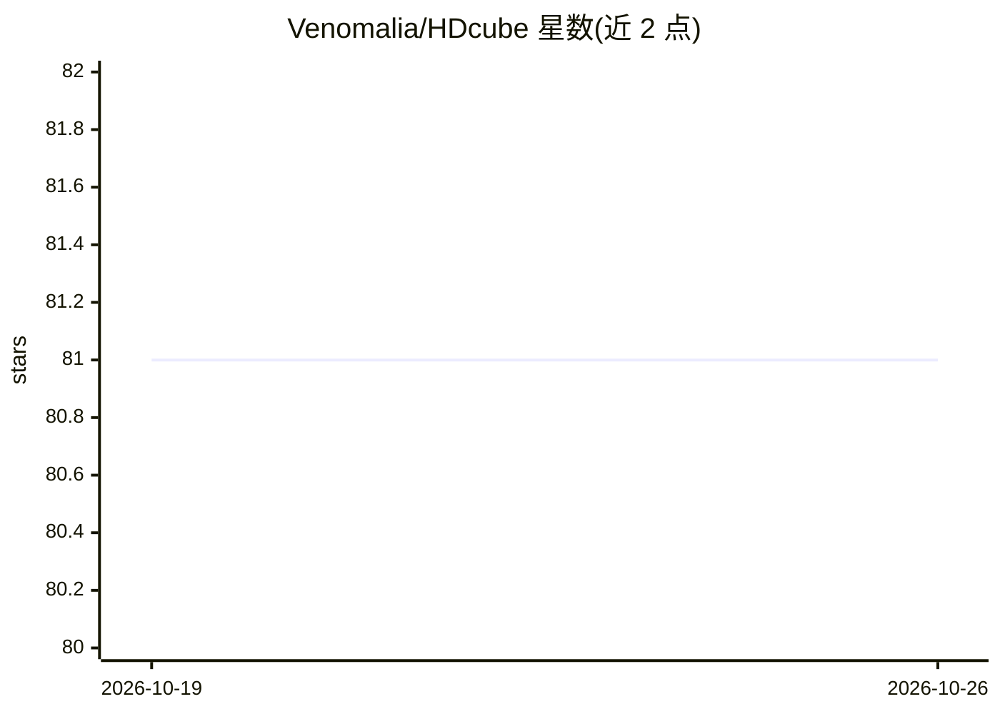

# Venomalia/HDcube

⭐ 81 · NOASSERTION · 推送 2026-10-19 · [GitHub](https://github.com/Venomalia/HDcube) · 个人维护

**面向 GameCube/Wii 贴图的 ESRGAN 超分辨率模型集**

一组基于 ESRGAN/Real-ESRGAN 架构训练的图像超分与修复模型，共 9 个版本（2x/4x 倍率，迭代 20 万至 60 万次），训练目标是 GameCube 与 Wii 游戏贴图，也可用于同时期 PS2、Xbox、PC 游戏贴图。可处理 Gamecube/Wii 硬件支持的全部图像格式，并能去除 CMPR 块压缩（DXT1/BC1）、调色板错误、8 位色深与 1 位 alpha 深度缩减等典型伪影。README 推荐通过 chaiNNer 图形化节点工具使用，并建议对 alpha 通道单独上采样以获得最佳质量。

## 筛选速览

| 维度 | 判定 | 备注 |
|---|---|---|
| AI 角色 | `ai-native` | 本体是模型或模型工具 |
| 许可风险 | `none` | NOASSERTION |
| 部署形态 | `None` |  |
| 模型依赖 | — | README 未给出锁定关系 |
| 硬件要求 | — | 无带数字的原话,不猜 |
| 安装摩擦 | `low` | 无编译、无系统依赖或容器化 |
| 成熟度 | — | 结构信号不足 |

## 能力要点

- 9 个 ESRGAN/Real-ESRGAN 系列模型，支持 2x/4x 上采样
- 针对性去除 CMPR 块压缩、调色板错误、色深缩减等 GameCube/Wii 贴图伪影
- 可处理 Gamecube/Wii 硬件支持的全部图像格式
- 建议 alpha 通道单独上采样以获得最佳质量

## 适用场景

- 为 GameCube/Wii 游戏制作高清材质包
- 修复同时期 PS2/Xbox/PC 游戏贴图的压缩伪影
- 通过 chaiNNer 节点流程批量上采样贴图

## 场景标签

`图像视频处理` · 领域:感知与多模态

## 证据(README 行号)

> L2: This is an ESRGAN model trained specifically for upscaling and restoration of GameCube and Wii textures, but it can 
> L29: |4|HDcube4Compact|400k|Real-ESRGAN Compact|2023-06-26|

## 星数曲线

2026-10-19 81 → 2026-10-26 81（+0）

---
*卡片 v1 · prompt 1.4 · 生成 2026-10-24 · 置信度 high · 依据 README sha `156b751ad4e5` · [字段定义](../../DATASET.md)*
