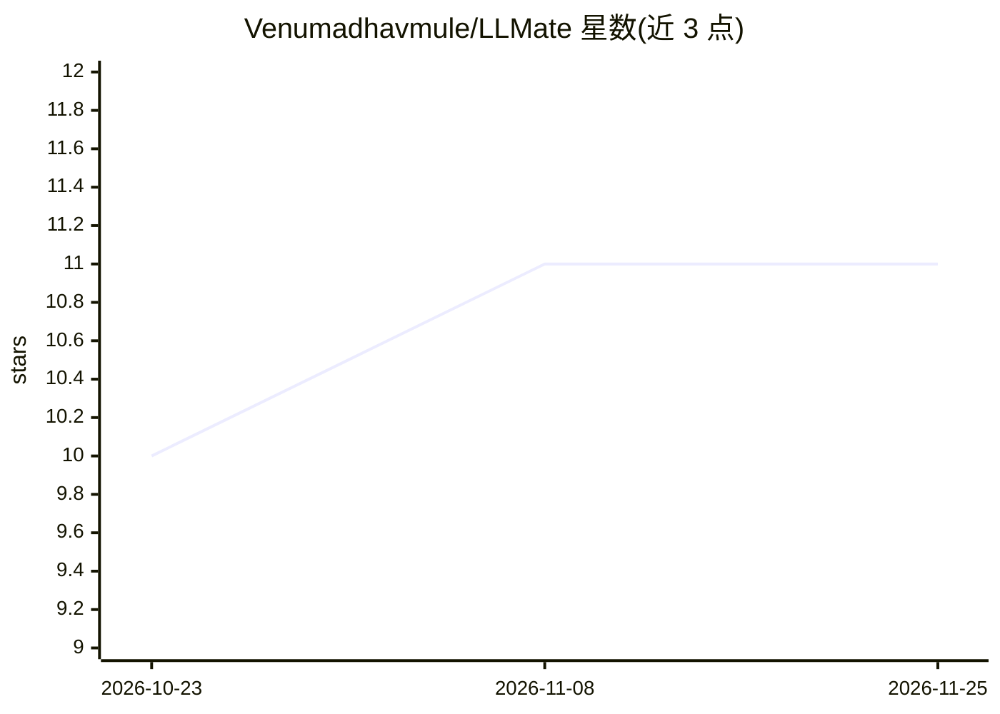

# Venumadhavmule/LLMate

⭐ 11 · Java · Apache-2.0 · 推送 2026-05-13 · [GitHub](https://github.com/Venumadhavmule/LLMate) · 个人维护

**JVM 版 LLM 网关：统一 REST API 接入 16 家模型服务商**

基于 Spring Boot 的 LLM 网关，将 OpenAI、Anthropic、Google Gemini、Ollama 等 16 家服务商统一到 /api/v1/chat 单一端点，提供模型别名路由、自动 fallback 链、SSE 流式输出，以及 embeddings、图像生成、音频转写、TTS、内容审核等多模态端点；内置 PGVector 的 RAG 管道与 Resilience4j 重试/熔断、Prometheus 指标。需 Java 21+ 与 Maven 构建，运行需至少一个 API key。附带官方 React 前端 LLMate Chat。

## 筛选速览

| 维度 | 判定 | 备注 |
|---|---|---|
| AI 角色 | `ai-ecosystem` | LLM/agent 周边工具 |
| 许可风险 | `permissive` | Apache-2.0 |
| 部署形态 | `self-host` | docker 或自建部署 |
| 模型依赖 | local-ok | 支持本地模型 |
| 硬件要求 | — | 无带数字的原话,不猜 |
| 安装摩擦 | `low` | 无编译、无系统依赖或容器化 |
| 成熟度 | — | 结构信号不足 |

## 能力要点

- 16 家服务商统一到单一 /api/v1/chat 端点，配置切换模型
- 命名别名路由与自动 fallback 链（配置驱动，无需改代码）
- 内置 RAG 管道（PGVector）与 Resilience4j 重试/熔断
- Prometheus + Grafana 指标与 SSE 流式（纯文本/JSON 两种格式）

## 适用场景

- 用统一 REST API 在多个 LLM 服务商间切换与路由
- 为主模型配置 fallback 链保证服务可用
- 通过一个网关统一收集各服务商延迟、token 用量与错误率指标
- 在网关层搭建文档摄入与检索增强生成流程

## 场景标签

`模型网关` `RAG` · 领域:Agent 开发

## 证据(README 行号)

> L3: **The LiteLLM for the JVM — one REST API for every LLM provider.**
> L5: Stop juggling SDKs. LLMate is a Spring Boot gateway that unifies OpenAI, Anthropic, Google Gemini, Ollama, and 12 mo
> L319: 2. **LlmRouter** resolves the `model` field through 5 steps: LiteLLM shorthand → named alias → explicit provider/m

## 星数曲线

2026-10-23 10 → 2026-11-25 11（+1）

---
*卡片 v1 · prompt 1.4 · 生成 2026-11-18 · 置信度 mid · 依据 README sha `fea1be82018f` · [字段定义](../../DATASET.md)*
