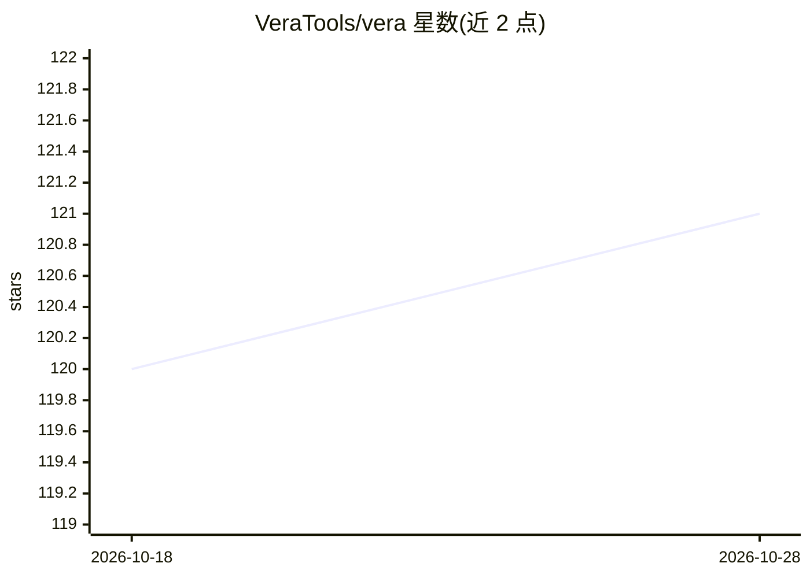

# VeraTools/vera

⭐ 121 · Rust · MIT · 推送 2026-10-28 · [GitHub](https://github.com/VeraTools/vera) · 个人维护

**面向 AI 编程代理的本地代码搜索引擎（Rust）**

用 Rust 编写的本地代码搜索工具：用 tree-sitter 将 65 种语言的源码解析为符号级分块，查询同时执行 BM25 关键词检索（Tantivy）与向量嵌入检索，经排名融合、可选重排与代码感知排序后返回带文件路径、行号区间的函数/类结果，另支持定义、引用、路由、环境变量等结构性查询。默认嵌入模型跑在 CPU 上，无需 GPU 或 API key，索引存储在项目内 .vera/ 目录；提供 MCP server 与 30 余个 agent 客户端的技能安装，支持 API 后端（OpenAI 兼容端点含本地 llama.cpp）。

## 筛选速览

| 维度 | 判定 | 备注 |
|---|---|---|
| AI 角色 | `ai-ecosystem` | LLM/agent 周边工具 |
| 许可风险 | `permissive` | MIT |
| 部署形态 | `library` | 以包/库形式分发 |
| 模型依赖 | local-ok | 支持本地模型 |
| 硬件要求 | — | 无带数字的原话,不猜 |
| 安装摩擦 | `medium` | 含编译或系统依赖之一 |
| 成熟度 | — | 结构信号不足 |

## 能力要点

- BM25 与向量检索并行、融合加可选重排与代码感知排序
- tree-sitter 解析 65 种语言，54 种支持符号级分块
- 默认 CPU 后端离线运行，无需 GPU、API key 或服务器
- 内置 MCP server（7 个工具）与 30 余个 agent 客户端的技能安装

## 适用场景

- 让 AI 编程代理按行为或名称定位代码
- 查找符号定义、调用者、路由与环境变量读取
- 在离线本地环境对代码库做语义检索

## 场景标签

`语义搜索` · 领域:知识与检索

## 证据(README 行号)

> L12: **Local code search for AI coding agents and the developers who use them.**
> L47: **It is built for agents.** `vera agent install` adds a Vera skill to more than 30 agent clients, including Claude 
> L62: `vera mcp` runs an MCP server over stdio with seven tools: `search_code`, `get_overview`, `regex_search`, `structur

## 星数曲线

2026-10-18 120 → 2026-10-28 121（+1）

---
*卡片 v1 · prompt 1.4 · 生成 2026-10-23 · 置信度 high · 依据 README sha `f76d6fd5303b` · [字段定义](../../DATASET.md)*
