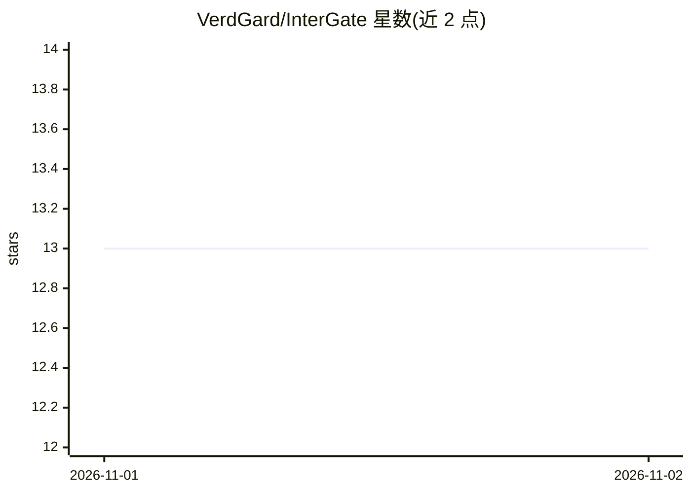

# VerdGard/InterGate

⭐ 13 · Python · AGPL-3.0 · 推送 2026-10-31 · [GitHub](https://github.com/VerdGard/InterGate) · 个人维护 · 中文 README

**自托管 AI API 中转网关：统一管理多厂商 Key 并做负载均衡**

基于 Python 的自托管 AI API 网关，在 Termux/Linux 上运行，统一管理 openai/anthropic/google/azure 等多家上游 API Key。提供 6 种负载均衡策略、失败自动切换与冷却恢复、多维限流（IP/全局/Key RPM、AIMD 自适应 TPM）、响应缓存、额度监控与告警、模型列表同步，并带 7 页签 Web 控制台。对外暴露 OpenAI 兼容接口（/v1/*），第三方应用改 base_url 即可接入；API Key 以 AES-256-GCM 加密存储，支持多租户 Token、Prometheus 指标。

## 筛选速览

| 维度 | 判定 | 备注 |
|---|---|---|
| AI 角色 | `ai-ecosystem` | LLM/agent 周边工具 |
| 许可风险 | `viral` | AGPL-3.0 |
| 部署形态 | `None` |  |
| 模型依赖 | locked-api |  |
| 硬件要求 | — | 无带数字的原话,不猜 |
| 安装摩擦 | `low` | 无编译、无系统依赖或容器化 |
| 成熟度 | — | 结构信号不足 |

## 能力要点

- 6 种负载均衡策略（轮询/加权/优先级/最少连接/响应时间/智能）
- 失败自动切换与连续失败冷却，单请求最多切换 3 个 Key
- API Key AES-256-GCM 加密存储，明文不落盘不写日志
- 多租户 Token 体系：独立日额度、限流、模型白名单、提供商限定

## 适用场景

- 把多家 AI 服务商 Key 聚合为一个 OpenAI 兼容端点供应用调用
- 在手机 Termux 上跑一个自用的 API 中转与额度监控网关
- 为团队按租户分配 Token 并限制各自额度与可用模型

## 场景标签

`模型网关` · 领域:Agent 开发

## 证据(README 行号)

> L8: 第三方 AI 应用(ChatBox、NextChat、Open WebUI、自定义脚本...)只需把 `base_url` 指向本网关,
> L42: |代理网关|`http://0.0.0.0:51234`|OpenAI 兼容 API(`/v1/chat/completions` 等)|

## 星数曲线

2026-11-01 13 → 2026-11-02 13（+0）

---
*卡片 v1 · prompt 1.4 · 生成 2026-10-31 · 置信度 high · 依据 README sha `02b47b69d0af` · [字段定义](../../DATASET.md)*
