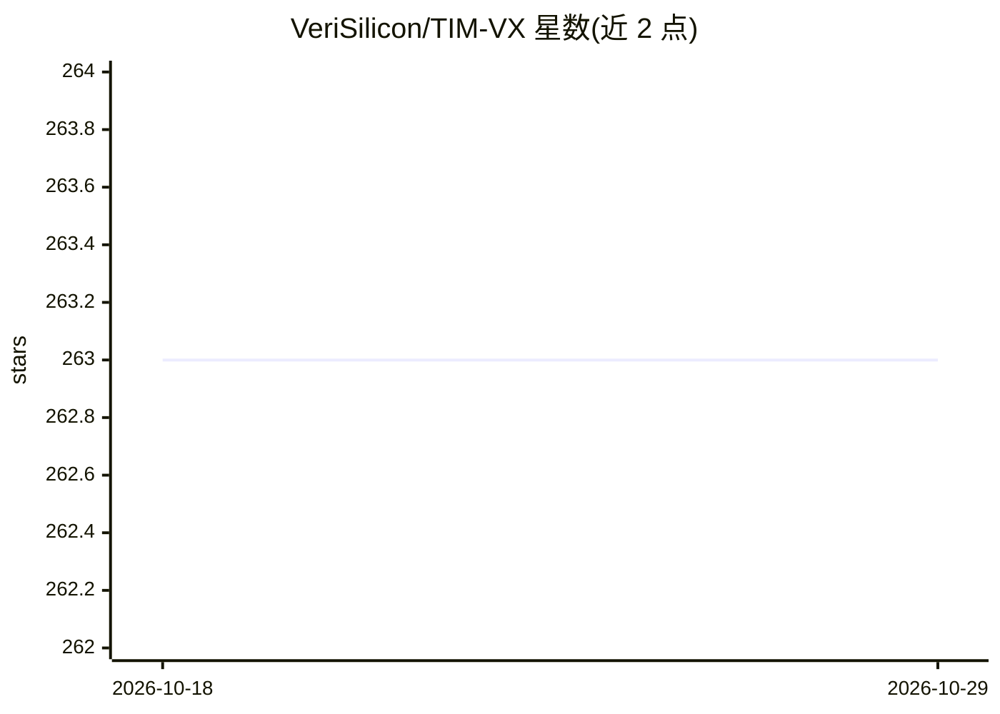

# VeriSilicon/TIM-VX

⭐ 263 · C · NOASSERTION · 推送 2026-03-30 · [GitHub](https://github.com/VeriSilicon/TIM-VX) · 组织维护

**VeriSilicon NPU 的神经网络部署后端绑定模块（C++）**

VeriSilicon 提供的软件集成模块，用于将神经网络部署到 VeriSilicon ML 加速器（NPU）上，作为 Android NN、TensorFlow-Lite、TVM、MLIR 等运行时框架的后端绑定。提供 150 余个算子（支持量化与浮点）、C++ Tensor/Operation 构建 API、动态图构建与 shape/layout 推断、自定义层扩展和调试工具函数。支持 bazel 与 cmake 构建；需编译链接 VeriSilicon OpenVX SDK，x86 平台可用预置模拟环境 SDK，平台 SDK 需从 SoC 厂商获取。

## 筛选速览

| 维度 | 判定 | 备注 |
|---|---|---|
| AI 角色 | `ai-ecosystem` | LLM/agent 周边工具 |
| 许可风险 | `none` | NOASSERTION |
| 部署形态 | `None` |  |
| 模型依赖 | — | README 未给出锁定关系 |
| 硬件要求 | — | 无带数字的原话,不猜 |
| 安装摩擦 | `medium` | 含编译或系统依赖之一 |
| 成熟度 | — | 结构信号不足 |

## 能力要点

- 150 余个算子，支持量化与浮点格式
- 动态图构建，支持 shape 与 layout 推断
- 内建自定义层扩展与调试工具函数
- 接入 TensorFlow-Lite（外部 Delegate）、Tengine、TVM、Paddle-Lite、OpenCV、ONNXRuntime 等框架

## 适用场景

- 在 VeriSilicon NPU SoC 上部署和运行神经网络模型
- 为 TensorFlow-Lite/TVM 等框架提供 VeriSilicon 后端
- 在 x86 PC 上用模拟 SDK 编译验证模型与算子

## 场景标签

`推理引擎` · 领域:训练与推理

## 证据(README 行号)

> L7: TIM-VX is a software integration module provided by VeriSilicon to facilitate deployment of Neural-Networks on Veris
> L18: - Tensorflow-Lite (External Delegate)

## 星数曲线

2026-10-18 263 → 2026-10-29 263（+0）

---
*卡片 v1 · prompt 1.4 · 生成 2026-10-22 · 置信度 high · 依据 README sha `2c3a5ba973e5` · [字段定义](../../DATASET.md)*
