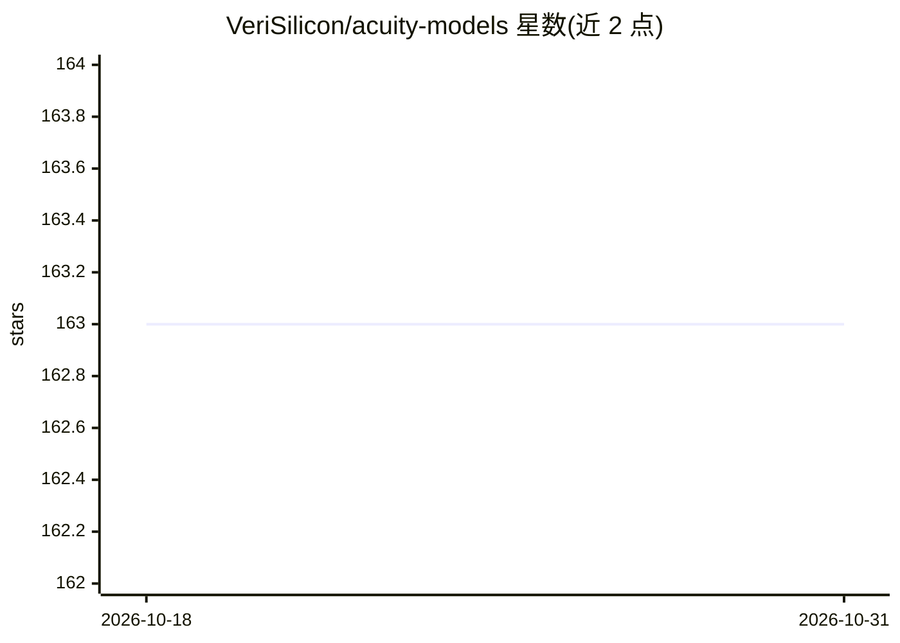

# VeriSilicon/acuity-models

⭐ 163 · JavaScript · 推送 2026-09-10 · [GitHub](https://github.com/VeriSilicon/acuity-models) · [官网](https://verisilicon.github.io/acuity-models/) · 组织维护

**面向 Vivante NPU 硬件的神经网络模型库（Acuity Model Zoo）**

VeriSilicon 维护的 Acuity 模型库，收录分类、检测、人脸识别、分割、超分辨率、姿态估计、LLM/VLM/TTS/OCR 等各类神经网络模型，由 Acuity 工具链创建或从 Caffe/TensorFlow/PyTorch/TFLite/DarkNet/ONNX 转换而来。配套介绍 Acuity 框架能力：量化、图优化、剪枝、训练验证与生成可在 OpenVX 平台运行的推理代码；模型以 JSON 描述，可经 netron（4.6.8 起）在线可视化。面向将模型部署到 Vivante NPU IP 硬件的开发者。

## 筛选速览

| 维度 | 判定 | 备注 |
|---|---|---|
| AI 角色 | `ai-knowledge` | 知识聚合/清单类 |
| 许可风险 | `none` | — |
| 部署形态 | `None` |  |
| 模型依赖 | — | README 未给出锁定关系 |
| 硬件要求 | — | 无带数字的原话,不猜 |
| 安装摩擦 | `low` | 无编译、无系统依赖或容器化 |
| 成熟度 | — | 结构信号不足 |

## 能力要点

- 覆盖分类/检测/分割/姿态估计/超分辨率等视觉模型及 LLM/VLM/TTS/OCR 模型
- 支持从 Caffe、TensorFlow、PyTorch、ONNX、TFLite、DarkNet、Keras 导入转换
- 配套 Acuity 工作流：量化、图优化、张量剪枝、推理代码生成
- 模型可视化查看器为 netron 的一部分（自 4.6.8 起）

## 适用场景

- 查找可部署到 Vivante NPU 平台的预训练模型
- 了解 Acuity 工具链从模型导入到硬件推理的流程
- 验证目标网络在 NPU 运行时栈上的可用性

## 场景标签

`推理引擎` `模型量化` · 领域:训练与推理

## 证据(README 行号)

> L3: Acuity model zoo contains a set of popular neural-network models created or converted (from Caffe, Tensorflow, PyTor
> L192: ## About Acuity
> L194: Acuity is a python based neural-network framework built on top of Tensorflow, it provides a set of easy to use hig

## 星数曲线

2026-10-18 163 → 2026-10-31 163（+0）

---
*卡片 v1 · prompt 1.4 · 生成 2026-10-22 · 置信度 high · 依据 README sha `f59f317567c2` · [字段定义](../../DATASET.md)*
