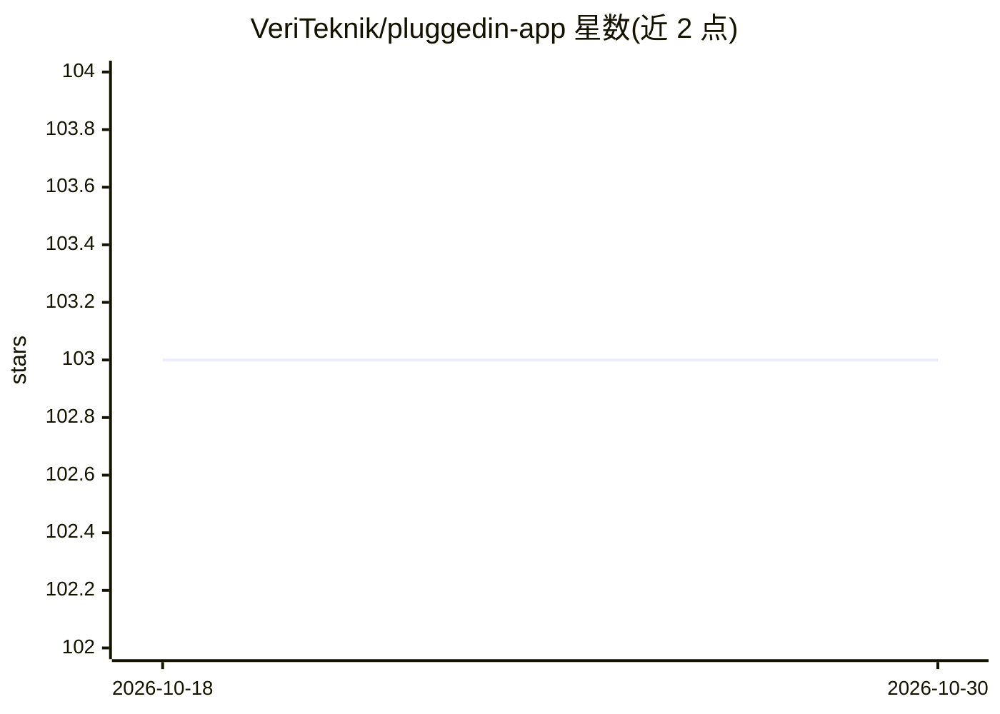

# VeriTeknik/pluggedin-app

⭐ 103 · TypeScript · MIT · 推送 2026-10-24 · [GitHub](https://github.com/VeriTeknik/pluggedin-app) · [官网](https://plugged.in) · 组织维护

**自托管 MCP 服务器管理与 AI 内容平台，统一发现、配置与聚合多源 AI 工具**

面向需要统一管理 MCP 生态的团队与开发者：以 Next.js 15 Web 应用形式提供 MCP 服务器注册表（1,500+ 条目）、MCP Proxy 聚合网关（单连接代理多服务器，含工具前缀与 OAuth）、嵌入式 RAG 知识库（zvec 引擎，RocksDB+HNSW，无需外部向量库）、文档版本管理与多模型归属、剪贴板/记忆系统。通过 docker compose 自源码构建部署，含 PostgreSQL 18/pgvector 与 Redis；提供 JS/Python/Go SDK。限制：自托管镜像需本地编译（首构建约 10-15 分钟，Docker 需约 8GB 内存）；官方托管服务将迁移至新平台，本仓库转为社区维护（至 2026 年 12 月底 v1 继续运行）。

## 筛选速览

| 维度 | 判定 | 备注 |
|---|---|---|
| AI 角色 | `ai-ecosystem` | LLM/agent 周边工具 |
| 许可风险 | `permissive` | MIT |
| 部署形态 | `self-host` | docker 或自建部署 |
| 模型依赖 | — | README 未给出锁定关系 |
| 硬件要求 | — | 无带数字的原话,不猜 |
| 安装摩擦 | `low` | 无编译、无系统依赖或容器化 |
| 成熟度 | — | 结构信号不足 |

## 能力要点

- MCP Proxy 网关：单一连接代理多台 MCP 服务器，含工具前缀与 OAuth 处理
- 嵌入式 RAG：zvec 向量引擎（RocksDB+HNSW），无需外部向量数据库
- 文档版本控制与多模型归属追踪（记录哪个 AI 贡献了什么）
- JS/Python/Go 官方 SDK 提供程序化访问

## 适用场景

- 我需要在一个界面里发现、配置和管理大量 MCP 服务器
- 我想让 Claude Code、Cline 等多个 AI 客户端共享同一套 MCP 工具配置
- 我想把 AI 对话产出的文档沉淀为可版本化、可语义检索的组织知识库

## 场景标签

`知识库管理` `模型网关` · 领域:Agent 开发

## 证据(README 行号)

> L46: ### 🔌 **Universal MCP Integration**
> L129: - **1,500+ Integrations**: Connect to any MCP-compatible tool

## 星数曲线

2026-10-18 103 → 2026-10-30 103（+0）

---
*卡片 v1 · prompt 1.4 · 生成 2026-10-23 · 置信度 mid · 依据 README sha `aa816c9363ef` · [字段定义](../../DATASET.md)*
