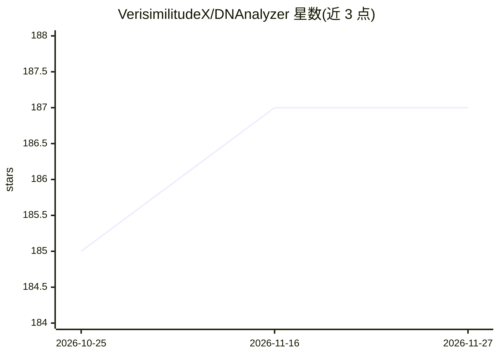

# VerisimilitudeX/DNAnalyzer

⭐ 187 · Java · MIT · 推送 2026-11-23 · [GitHub](https://github.com/VerisimilitudeX/DNAnalyzer) · 个人维护

**本地化隐私 DNA 分析平台：基因数据不出设备**

DNAnalyzer 是一个以本地计算为核心的基因组分析工具：解析 FASTA/FASTQ 及纯文本序列，提供密码子与蛋白质编码区检测、GC 富集区与启动子元件识别、神经相关基因组标记筛查、大陆级祖源估计与多基因风险评分；比对模块可选 PyOpenCL GPU 加速并有 CPU 回退。以 CLI、Spring Boot REST API 与 Web UI 形式交付，支持 Docker Compose 一键部署或 Gradle 源码构建。可选接入 OpenAI 生成报告；性状预测声明仅供教育用途，不用于医疗决策。

## 筛选速览

| 维度 | 判定 | 备注 |
|---|---|---|
| AI 角色 | `ai-native` | 本体是模型或模型工具 |
| 许可风险 | `permissive` | MIT |
| 部署形态 | `self-host` | docker 或自建部署 |
| 模型依赖 | — | README 未给出锁定关系 |
| 硬件要求 | — | 无带数字的原话,不猜 |
| 安装摩擦 | `low` | 无编译、无系统依赖或容器化 |
| 成熟度 | — | 结构信号不足 |

## 能力要点

- 密码子/蛋白质检测、GC 富集区与启动子元件（BRE/TATA/INR/DPE）识别
- 23andMe/AncestryDNA 基因型文件的多基因风险评分，缺失变异会被标记
- Smith-Waterman 比对可选 PyOpenCL GPU 加速，纯 Python CPU 回退
- CLI、REST API（/api/v1）与 Web UI 三种使用方式，含 Swagger 文档

## 适用场景

- 在本地对 FASTA 序列批量做蛋白质与启动子分析
- 解析 23andMe/AncestryDNA 导出数据生成风险评分报告
- 通过 REST API 将序列分析集成到自动化流程

## 场景标签

 · 领域:生物信息学/基因组分析

## 证据(README 行号)

> L19: DNAnalyzer is an AI-powered, privacy-first platform for genomic analysis. All computation happens locally on your d
> L40: |Codon and protein detection|Identifies protein-coding regions, amino-acid chains, and genomic indicators|
> L47: |Polygenic risk scoring|Per-variant contribution reports with missing-variant flags|

## 星数曲线

2026-10-25 185 → 2026-11-27 187（+2）

---
*卡片 v1 · prompt 1.4 · 生成 2026-11-26 · 置信度 high · 依据 README sha `69223e076c58` · [字段定义](../../DATASET.md)*
