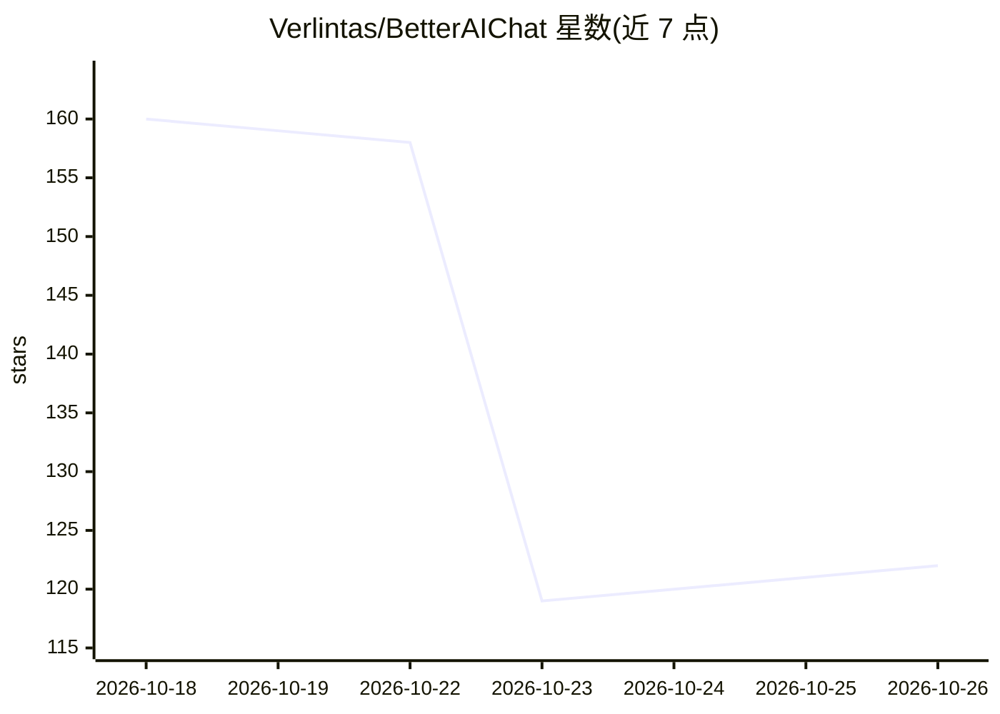

# Verlintas/BetterAIChat

⭐ 122 · Kotlin · MIT · 推送 2026-10-24 · [GitHub](https://github.com/Verlintas/BetterAIChat) · 个人维护 · 中文 README

**Android 原生 AI 助手：自有 API Key 对话并操作手机**

Kotlin/Jetpack Compose 编写的本地优先 Android AI agent 应用：用户填入自己的 API Key（OpenAI 兼容/Anthropic/Gemini），密钥经 Android Keystore 加密存储，无云端中转。支持流式对话、四种 opencode 风格模式（Chat/Plan/Build/Max），内置约 50 个设备工具：打开应用、截屏 OCR、Shizuku root shell、无障碍 UI 自动化、多引擎网页搜索、定时/电量触发自动化、语音免提模式与长期记忆。可通过 Releases 下载 APK 或用 JDK 17 + Android SDK 从源码构建，MIT 许可。

## 筛选速览

| 维度 | 判定 | 备注 |
|---|---|---|
| AI 角色 | `ai-native` | 本体是模型或模型工具 |
| 许可风险 | `permissive` | MIT |
| 部署形态 | `None` |  |
| 模型依赖 | local-ok | 支持本地模型 |
| 硬件要求 | — | 无带数字的原话,不猜 |
| 安装摩擦 | `medium` | 含编译或系统依赖之一 |
| 成熟度 | — | 结构信号不足 |

## 能力要点

- 约 50 个设备工具：截屏 OCR、Shizuku shell、无障碍 UI 自动化（tap/swipe/找文本）
- 四种 opencode 风格模式，Max 模式自主多步工具调用
- 时间/电量触发的后台自动化任务引擎
- SKILL.md 格式自定义技能与动作录制器
- API Key 本地 Keystore 加密，无云端

## 适用场景

- 用自己的 API Key 在手机上与多个 LLM 对话
- 让 AI 代为操作手机：开应用、设提醒、UI 自动化
- 搭建免root/需Shizuku的手机自动化任务
- 语音免提问答与长期记忆的个人助理

## 场景标签

`AI 助手` `聊天机器人` `GUI 自动化` `Agent 记忆` · 领域:Agent 开发

## 证据(README 行号)

> L7: > A native Android AI assistant that uses **your own API keys**. Chat with leading LLMs, and let the AI operate your
> L9: Unlike mainstream AI apps, BetterAIChat is a **local-first agent**: your API keys are encrypted on-device, there is 
> L41: ### The AI can operate your device

## 星数曲线

2026-10-18 160 → 2026-10-26 122（-38）

---
*卡片 v1 · prompt 1.4 · 生成 2026-10-22 · 置信度 high · 依据 README sha `e261abb7bab9` · [字段定义](../../DATASET.md)*
