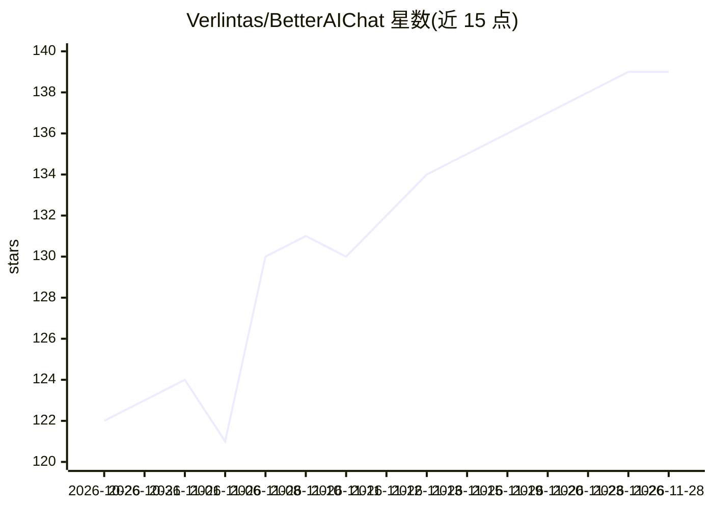

# Verlintas/BetterAIChat

⭐ 139 · Kotlin · MIT · 推送 2026-11-21 · [GitHub](https://github.com/Verlintas/BetterAIChat) · 个人维护 · 中文 README

**本地优先的 Android AI 助手：自带 API key，AI 可操作手机**

Kotlin/Jetpack Compose 构建的原生 Android 应用，用户填入自己的 API key 接入多家 LLM；AI 通过 function calling 操作设备，内置 50+ 工具（开关应用、截图、屏幕 OCR、无障碍 UI 自动化、Shizuku root shell、多引擎网页搜索、日历/邮件等）。提供 Chat/Plan/Build/Max 四种 opencode 风格模式、SKILL.md 技能导入、本地长期记忆、自动化任务与语音助手。API key 经 Android Keystore 加密存于本地，无云端。APK 从 Releases 下载，也可 JDK 17 + Android SDK 源码构建。

## 筛选速览

| 维度 | 判定 | 备注 |
|---|---|---|
| AI 角色 | `ai-native` | 本体是模型或模型工具 |
| 许可风险 | `permissive` | MIT |
| 部署形态 | `None` |  |
| 模型依赖 | local-ok | 支持本地模型 |
| 硬件要求 | — | 无带数字的原话,不猜 |
| 安装摩擦 | `medium` | 含编译或系统依赖之一 |
| 成熟度 | — | 结构信号不足 |

## 能力要点

- 50+ 设备工具：截图、屏幕 OCR、无障碍 UI 自动化、Shizuku shell、应用管理
- Chat/Plan/Build/Max 四种模式控制工具执行与推理强度
- SKILL.md 技能导入与工具序列录制复用
- 本地长期记忆蒸馏、上下文 85% 自动压缩

## 适用场景

- 用自己配置的模型在手机上对话并让 AI 执行操作
- 语音免手操作：口述问题、AI 朗读回答
- 把多步任务录成 Skill 或定时自动化重复执行

## 场景标签

`AI 助手` `聊天机器人` `语音 Agent` · 领域:对话与助手

## 证据(README 行号)

> L7: > A native Android AI assistant that uses **your own API keys**. Chat with leading LLMs, and let the AI operate your
> L9: Unlike mainstream AI apps, BetterAIChat is a **local-first agent**: your API keys are encrypted on-device, there is 
> L20: - **Multiple providers**: OpenAI-compatible (OpenAI, DeepSeek, Moonshot, Qwen, Ollama, any gateway), Anthropic Clau

## 星数曲线

2026-10-26 122 → 2026-11-28 139（+17）

---
*卡片 v1 · prompt 1.4 · 生成 2026-11-27 · 置信度 high · 依据 README sha `72148eb88ea4` · [字段定义](../../DATASET.md)*
